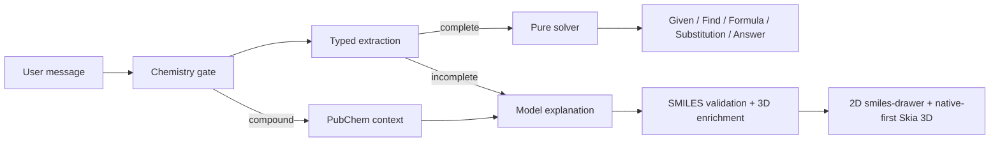

# Recall chemistry pipeline

Server-side typed extractors, pure solvers, RDKit, SymPy, and PubChem verify
chemistry. The mobile app renders the result; it does not solve chemistry on-device.

## Default product path

1. **Gate** (`request.py`) — recognizes supported calculations, chemistry-specific
   language, element questions, descriptors, and compound lookup. Generic phrases such
   as “how many” do not fire the chemistry path on their own, and neither do words that
   are chemistry only in company (`acid`, `base`, `boiling`, `nuclear`, `mole`,
   `compound`, `bond`): those need a second cue or a chemical formula. Symbols such as
   `Ka`, `pH`, and `Rf` match only with that capitalization (not “KB” or “Ph.D.”), and
   a scientist's name needs “law” (Charles's law, not Charles Darwin). “Chemistry” is
   the subject except in the idiom for getting along (“great chemistry”, “the chemistry
   between them”), and a half-life needs a number, a nuclide or a decay word (not a phone
   battery's). The gate reads
   the first and last 2,000 characters and its formula pattern is linear-time, so a
   long paste cannot stall the event loop. PubChem lookups on the turn path give up
   after 2 seconds. A few closed shapes are cues of their own: a particle count in powers
   of ten of a real substance ("1.20 × 10^24 atoms of iron"), particles beside a compound
   formula, an element's share of a compound ("what % of Fe2O3 is iron"), two gases each
   with its pressure, `% by mass`, "mole fraction", `E°` and `E°cell`, a stock solution
   (`12 M HCl stock`, never "3 M Company stock"), "collected over water", and the name or
   formula of a salt the ion table holds ("the name of Fe2(SO4)3"), and a reaction with an
   amount stated and one asked, written or told in words ("how much water do i get if i burn
   like 4g of h2"; never "plan A -> B, how much", whose sides are not substances). A lookup's
   gate is read in the SymPy pool with the solve, never on the event loop.

   Every reader (the gate, extraction, the binder, turn context) first reads the text as
   ASCII (`input_text.py`), since a student often copies the app's own typeset reply back:
   `H₂SO₄` is `H2SO4`, `Fe³⁺` is `Fe^3+`, `10⁻³` is `10^-3`, and a hydrate's dot (`.`, `·`,
   `•`, `*`) is one `·`, so `CuSO4.5H2O` is one formula with its water. A lowercase `ph`
   beside its value or before a molar concentration is `pH`, and `=` between two sides of
   formulas is the arrow of an equation the question asks to balance
   (`Al + HCl = AlCl3 + H2`). A question chemistry cannot close is still chemistry's,
   not maths', when it has a pH or K symbol, an amount in M or mol, a compound's formula or
   a written reaction (`services/subject_solving.detect_subject`): maths read the `x` of
   `1.8 x 10^-5` as its unknown.
2. **Extract** (`extract.py`) — converts a complete, unambiguous text problem to a
   validated `ChemistryIntent`. Missing or conflicting values return `None`; the
   extractor never invents a value. A number that carries a unit is converted, and a
   unit the registry cannot convert declines the problem instead of being read as the
   default unit. `1.8 × 10^-5` is read whole, never as `1.8`, by the shared
   `services/number_text` reader. One line is extracted once per turn: the result is
   cached per text and each caller gets its own copy. The templates in `extractors/`,
   one module per topic, read labelled phrasings ("Strong acid: 0.01 M HCl", "M1 = 2 M,
   V1 = 50 mL"). The first that returns an intent wins, so `registry.py` lists them in
   the order they run.
   A question in its own words ("What is the pH of 0.01 M HCl?") is read by the
   **binder** (`binding.py`) once every template has declined. It uses the law engine
   physics uses (`services/law_binding`):
   - the text is prepared first. A symbol whose case is its meaning is spelled out
     (`pH`, `Ka`, `E°`). Each substance named by formula or by name (`species_facts.py`:
     water, table salt, acetic acid…) becomes its role: strong or weak acid or base,
     conjugate salt, compound. Its digits are never read as numbers (the 2 of `Ca(OH)2`);
   - a law (`laws.py`) is tried only when the question names the substance it is
     about. A strong-acid pH needs exactly one strong acid;
   - the stated values fill the law's inputs by dimension (`given_units.py`: `M` is mol/L,
     `m` is mol/kg, `°C/m` a colligative constant) and by the words around them;
   - settings fill the rest:
     - the van 't Hoff factor of a named solute (glucose 1, NaCl 2);
     - the molar mass of the metal deposited, and the charge of its ion (`Cu2+`);
     - 25 °C for a Nernst cell with no temperature;
   - each input is converted to the unit its solver reads, so the solver is the same one
     a template reaches.

   Anything short of one law with one way to fill it declines: two strong acids, a
   weak acid without its Ka, a second time for one electrolysis. A per-mole value of a
   written equation (`2H2 + O2 -> 2H2O, ΔH = -572 kJ/mol`) is per mole of that reaction, so
   `q = nΔH` declines beside one. A question with no question verb asks for what it names: the
   sentence ending in a question mark ("Freezing point of 10.0 g NaCl in 250 g of water?
   Kf = 1.86 °C/m"), or its one sentence ("pH of 0.0025 M HCl"); a statement of a value ("The
   pH of 0.01 M HCl is 2.") is not a question about it. A titration in words
   pairs each volume with the solution it is "of" ("25 mL of 0.1 M HCl", "adding 10 mL of
   NaOH"); a volume no phrase ties to one solution declines. A binder fit is also a
   chemistry cue for the gate. A problem no reader knows goes to the model, unverified.

   A **reaction told in words** (`extractors/described.py`, live 2026-10-25: "how much water
   do i get if i burn like 4g of h2" got three answers from the model) is written as its
   balanced equation and read by the written-equation readers. Its substances are named
   (`species_words.py`): a common name (`NAMED_COMPOUNDS`: water, propane, glucose), a salt
   the ion table names (magnesium oxide), an element as it reacts (hydrogen is H2), a formula,
   or a lowercase formula with a digit that only one school substance fits ("co2", "nh3",
   "fe2o3"; "co", "hf" and "caco3" stay words). A fuel that burns, or reacts with oxygen or
   air, takes O2 and makes its oxides: C/H and C/H/O compounds make CO2 and H2O, H2 water,
   C and CO make CO2, S makes SO2, and Mg, Ca, Zn, Al and Li their one oxide, and nothing else
   (SO3 from sulfur, H2O2 from hydrogen, CO from carbon decline); any other fuel burns to an
   oxide of its own elements the question names (iron to Fe2O3, N2 to NO2). A burning called
   incomplete, limited, insufficient or partial declines. "X reacts with Y", "X and Y react",
   "X combines with Y" and "made from X and Y" make what the question asks about or names.
   The balancer has the last word: a product X and Y cannot make alone ("Zn reacts with HCl,
   grams of H2", ZnCl2 unnamed) declines, and a product is never guessed. The same naming
   reads a question beside a written equation ("2H2 + O2 -> 2H2O how much water from 4g of
   h2"). What the question asks is a closed grammar (`extractors/reaction_ask.py`): one head
   ("how much", "how many grams of", "what mass of"), the substance and a unit after it
   ("H2O molecules"), a verb that makes it ("do i get", "is produced") or uses it ("do i
   need", "reacts"), then the end of the clause or "if", "when", "from", "to burn". Anything
   else declines: "how much water do i need to drink", "do i exhale", "is left over", "in
   ml", "and h2". A substance asked as made must be a product ("how much oxygen is made"
   declines), every stated amount must be of a named substance ("in 100 g of air" declines),
   every word of a product list must be read ("to make co2 and co" declines), and "atoms of
   oxygen" is not O2's molecules. Burning in everyday words (a hand on a stove, 500 calories,
   4 g of fat) names no substance with an amount, and stays the model's. A follow-up changes
   the reaction it names (`reaction_followup.py`): "what if i only had 16g of o2" weighs a
   second reactant (O2 limits the water to 18 g), "what if it was 10 g of h2" replaces an
   amount, and "and how much o2 do i need" asks another substance. The last exchange's own
   problem is changed first ("what about 20 g of H2" after a moles question). The walk back
   to a reaction stops at the first newer user line that states an amount with a unit, so a
   heat problem in between is never answered as the reaction, and a change of a change
   declines; "back to the first one" with two reactions that hold the substance declines.
3. **Solve** (`solvers/`) — deterministic solvers, one module per topic (`amounts`,
   `stoichiometry`, `acid_base`, `titration`, `equilibrium`, `kinetics`, …), return
   `ChemistryResult` with Given, Find, named universal Formula, Substitution, and Answer
   fields; `solver.py` maps each operation to its solver. The catalog (`catalog.py`) is
   the one list of operations: `ChemistryIntent` refuses an operation it does not declare,
   or one it files under another kind.
4. **Respond** (`direct.py`) — a complete typed calculation returns the exact compact
   five-section answer without waiting for model prose. The value is a server
   ` ```answer ` fence with the header line `notation: chemistry` (after the server's
   `verified: true`, added when the reply is sent), so the client draws it as text
   instead of LaTeX, with the green check. Image questions remain on the vision/model
   path because OCR text was not the typed extractor input. Substitution is the
   formula with the numbers put in, never a repeat of the answer.
5. **Finalize** (`fence.py`) — a verified result drops model answer, scene, and
   structure fences and appends the solver's copies (the card marked `verified: true`).
   Prose whose own final value differs (`pH = 1.00` against `2.00`) gets one line above
   the card: "The verified answer is …". An unclosed model fence is closed
   first, so it cannot swallow the fences the server appends. Closed `smiles` /
   `chemistry` fences are then validated and rewritten in Kekulé form
   (`smiles.drawing_smiles`): smiles-drawer counts an aromatic bond as single when it
   adds hydrogens, so `c1ccncc1` drew an NH. The server appends `molecule3d` SDF for the
   first two valid structures, at most 120 heavy atoms each, so the client never has to
   drop an oversize block.
6. **Render** — smiles-drawer retains chemically aware 2D layout inside its sandboxed
   WebView. The interactive 3D molecule projection uses a native Skia canvas, with the
   same projected SVG scene as a safe Expo Go / stale-client fallback. Adjacent 2D and
   3D fences collapse into one molecule card.



## Formula vs SMILES (`molar_mass`)

Hill formulas (`CO`, `C`, `H2O`, hydrates such as `CuSO4.5H2O`) are summed from
the element table (`elements.py`), so RDKit cannot saturate them into hydrides. Organic
strings that use SMILES-only syntax (`=`, `#`, `@`, ring-closure digits such as
`C1CCCCC1`), or strings such as `CCO`, use RDKit. `NaCl` stays a formula. Molar mass is shown to two decimals (glucose 180.16 g/mol).

## Adding an operation

The catalog (`catalog.py`) is the one list of operations; `ChemistryIntent` refuses anything
it does not declare. Pick the smallest shape that fits:

- **One line of arithmetic** (a molality, a Beer–Lambert absorbance): one `_law(...)` row in
  `formula_laws.py` (or `stated_laws.py` for the later one-number laws). The row is the
  catalog identity, the arithmetic (a `services/law_binding` expression that may name
  `{N_A}`, `{R_J}`, `{R_atm}` and `{F}`, never their numbers) and the answer's rows;
  `solvers/formula.py` answers every row. To read it in a question's own words, add its
  binding to `formula_bindings.py` (or `stated_bindings.py`): the words that ask for it and
  how each input is named.
- **Its own working** (a titration region, an ICE table): a row in `catalog._ROWS`, the
  solver in `solvers/<topic>.py` registered in `solvers/solver.CHEMISTRY_SOLVERS`, and a
  reader: a labelled template in `extractors/<topic>.py`, placed in `registry.py` where its
  order comment allows, or a law in `laws.py` for the binder.
- **Shared pieces**: number display is `solvers/display.py` (`num`, `qty`, `fixed`, `const`)
  and its constants `solvers/constants.py`; formula and ion spans are `species_facts.py`
  (`formula_spans`, `without_formulas`); units go through `quantity.py` and
  `given_units.CHEMISTRY_UNITS`. A law physics already owns (gases, Q = mcΔT, half-lives)
  is not added here.
- **Tests**: `test_chemistry_remaining.py` holds the catalog to the solver map, and
  `test_chemistry_notation.py` needs a worked case (its `ALL_CASES`) for every solver
  operation; add the question, its look-alikes and a decline to `stem_corpus/chemistry/`.

## Shared chemistry primitives

Verified operations share one species model instead of one-off formula patches.

| Primitive | What it carries |
|---|---|
| Element | all 118 elements: atomic number, symbol, name, atomic mass, and, where a standard value exists, group, period, electronegativity, common oxidation states, and electron configuration. An element with no standard atomic weight (Tc, Pm, and every element from Po on except Th, Pa, and U) carries the mass number of a long-lived isotope, marked `*` in the source table. Helium, neon, argon, and radon omit electronegativity; krypton and xenon have one. |
| `ChemicalSpecies` | formula, elemental composition, ionic charge, and optional phase (`s`, `l`, `g`, `aq`) |
| `ChemicalReaction` | reactant and product terms, each a species plus a coefficient |
| Quantity | school units normalized through the shared Pint registry (`25 °C` → 298.15 K, mmHg/kPa/bar → atm, mL → L) by the extractors for gas states, solution volumes, and dilution, before a solver sees them. mM, µM, nM, kcal, g/L and g/mL are read by the readers that convert units (the binder and Michaelis–Menten): the labelled templates never see them, since `M1 = 5 mM` would read as 5 M. An unsupported unit declines |

Balancing builds a SymPy nullspace over atoms and, when any species is charged, over charge. It recounts both and refuses an underdetermined or non-positive coefficient set. Electrons are a species with charge −1 and no atoms. A glued `+` or `−` is charge (`Fe2+`, `MnO4-`, `SO4^2-`); `H2 + O2` stays a term separator. A polyatomic ion whose charge follows a digit (`Cr2O72-`) is ambiguous, so it must be written with a caret (`Cr2O7^2-`) or the equation is refused rather than balanced wrongly. Reaction arrows are `->`, `→`, `=>`, `-->`, `⟶`, `<=>`, `⇌`, `⇋`, `<->`, and `↔`, read longest first.

Pure solids and liquids are omitted from `Kc`, `Kp`, and solubility products only when the phase is written on the species. An unlabeled formula still counts, so a homogeneous concentration equilibrium is unchanged.

## Verified calculation coverage

| Group | Operations |
|---|---|
| Equations | atom-and-charge balancing (a misspelt "balence" is the same request), including ionic and redox half-equations that already contain `e-`; a written redox pair when the question asks to balance it or names a half-reaction, in acidic or basic solution, adding `H2O`, `H+` or `OH-`, and `e-`. The pair itself may be water, `H+`, or `OH-` (`O2 -> H2O`, `H+ -> H2`), including a one-element ion whose oxidation number is a fraction (`O2 -> O2-`). A pair whose oxidation numbers do not change stays with the ordinary balancer. `H2O -> H2` declines: cancelling the written water would leave a different pair. An ambiguous oxidation state such as FeS declines, and a multi-species equation is not completed into a full redox reaction |
| Amounts | molar mass (of a formula, or of a compound named in words: glucose is C6H12O6; "oxygen gas" is O2), mass ↔ moles (a mass asked in mg or kg is answered in it: `0.0150 mol` of NaOH is `600 mg`), mass ↔ moles, moles ↔ particles, particles ↔ mass (each of a hydrate too: `CuSO4·5H2O` is 249.68 g/mol): atoms are one element's ("the mass of `1.20 × 10^24` atoms of iron" is `111 g`), molecules and formula units a compound's or a diatomic element's ("molecules of oxygen" are O2), and "atoms of O2" or "molecules of iron" decline; a written equation leaves the count to stoichiometry, the atoms of one element in an amount of a compound, or their moles (`2.0 mol` of CO2 holds `2.4 × 10^24` O atoms; `2.0 mol` of H2SO4 holds `8.0 mol` of O atoms), percent composition, asked element first or compound first ("what % of Fe2O3 is iron" is `69.94%`; "what % of the atoms" declines), the mass of an element in a sample (`10.0 g` of H2O holds `8.88 g` of O), average atomic mass from isotope abundances (`extractors/isotope_average.py`: a mass the question states, in its isotope's own clause, as a list in the isotopes' order or in a table, beats the isotope table in `isotopes.py`, for every isotope or none, and an unstated mass is never the mass number; a value quoted as the answer, a number counted in grams, g/mol, moles or atoms, and a list led by anything but a mass noun are never masses; only the whole ask is certified, so a question that states the element's atomic mass, or also asks for moles, a composition or an isotope's mass or abundance, declines (`isotope_question.py`); four figures, never more places than the stated masses, and the mean of whole mass numbers is exact: boron's stated 10 and 11 at 20% and 80% is `10.8`, not `11`), percent yield, atom economy of one named product in an equation whose written coefficients already conserve atoms (a common multiple counts; the printed formula includes each coefficient), empirical formula (from percentages, or from each element's mass in a sample, which must add up to a stated sample mass; a salt is written in the order the question names its elements, `CaCO3`, and a carbon–hydrogen compound in Hill order), molecular formula, combustion analysis of a C/H/O compound (or carbon and hydrogen only) from the sample mass and the CO2 and H2O masses. Another element declines, and so do masses that do not close. A hydrate's water coefficient from the hydrate mass, the anhydrous mass, and the anhydrous formula (`CuSO4·5H2O`); a coefficient that is not a small integer declines |
| Stoichiometry | mole ratios between any two species of the balanced equation: a product from a reactant, the reactant needed for a product ("grams of KClO3 needed to produce 3.2 g of O2"), or one reactant for another ("moles of O2 needed to burn 3.0 mol of CH4"); what is left of a reactant (remaining, excess, unreacted) is another question and declines; grams, moles, or particles through the balanced ratio to grams, moles, or particles, asked "how many grams of", "what mass of" or "find the moles of", or after the substance ("How many H2O molecules" is particles); "how much H2O" asks in the unit its amount is given in (grams from grams) and "how many H2O" in moles; atoms of a molecule ("atoms of O2"), mL, kg or two units at once decline; the equation written or the reaction told in words (see Extract); every reactant weighed is a limiting-reagent question even without the word; percent yield through a written reaction (one reactant, or the others said to be in excess; more product than the reaction can make declines); solution volume/molarity → product; gas volume at the same P and T; limiting reagent from masses or solution volumes, with theoretical yield and excess reactant |
| Solutions | molarity, including from the mass of one named solute and the solution volume, or from moles in a volume in words ("0.25 mol KCl in 750 mL"), mass from molarity, dilution (including the stock volume: `6.0 M` to make `500 mL` of `1.5 M`, the stock also stated in a sentence of its own, "I have 12 M HCl stock"; and the final volume of "50 mL of 2.0 M HCl is diluted to 0.50 M"; water to add, or two substances, decline), molality (also from the solute and solvent masses), mass percent, mole fraction (also from the grams of two named components: `46 g` ethanol and `54 g` water give `χ = 0.25`), parts per million and parts per billion (mass of solute over mass of solution, from none of the solution up to all of it), volume percent, mass/volume percent (grams of solute per 100 mL of solution), boiling-point elevation and freezing-point depression from a molality, or from the solute's moles or grams (its molar mass from the table) and the solvent's mass (`2.00 mol` of glucose in `1.00 kg` of water). "The boiling point" of a solution is the solvent's normal point moved by that change, `Tb = Tb° + ΔTb` and `Tf = Tf° − ΔTf`: water's 100 °C and 0 °C are a setting when water is named (or the solution is aqueous), another solvent's is stated ("benzene boils at 80.1 °C"), and a question that asks how much the point changes is never read as the new point. The grams of solute in a mass of solution of a stated mass percent (`5.0%` of `500 g` is `25 g`); the grams of water for it, or a percent by volume, decline. The van 't Hoff factor when the temperature change, the colligative constant, and the molality are all stated (`i = ΔT / (K m)`; the elevation and depression still solve for `ΔT` and keep a named solute's `i` as the setting), osmotic pressure, Raoult's law for one component (`P = X P°`), the total vapor pressure of an ideal binary solution (`P = X_A P_A° + X_B P_B°`), ionic strength of two stated ions (`I = ½ Σ c_i z_i²`; a missing charge, a third ion, an activity coefficient, or Debye–Hückel declines), and a one-stage partition coefficient `KD = [A]org / [A]aq` (a multi-stage extraction declines). Mixing one solute from two solutions is `C = (C1 V1 + C2 V2) / (V1 + V2)`. Activity `a = γ c / c°` when the activity coefficient, the concentration, and the standard concentration are stated |
| Acid–base | pH from `[H+]`, pOH, or a strong monoprotic acid / strong base concentration (below `10^-6 M` water's ions count: `[H+] = C/2 + √(C²/4 + Kw)`, so `1.0 × 10^-8 M` HCl is pH 6.98), `[H+]` from "a pH of 4.75", and the pOH of that same strong acid or strong base; weak-acid and weak-base quadratics; `Ka` from a stated weak-acid concentration and pH; `Ka`/`Kb`/`Kw` and `pKa`/`pKb`; Henderson–Hasselbalch; buffer after adding strong acid or base; strong titration, weak acid–strong base, and weak base–strong acid regions; a neutralization's unknown concentration with the mole ratio (H2SO4 neutralizes two NaOH), the titrant's volume read from "it takes 32.45 mL to reach the endpoint", and the volume of a stated solution needed to neutralize another (`V₂ = C₁V₁ × ratio / C₂`: `0.250 M` H2SO4 for `50.0 mL` of `0.100 M` NaOH is `10.0 mL`); mixing an acid and a base is the titration's reaction; a constant stated in words ("the Kb of NH3 is 1.8 × 10^-5"); percent ionization; first dissociation of a polyprotic acid. An amphiprotic pH is `(pKa1 + pKa2) / 2` when both constants are stated. A stated concentration has to be high enough for that average (well above `Ka1` and `Kw/Ka2`); a very dilute salt declines. `[A2-]` is `Ka2` when that concentration is asked and the second dissociation is weak (`Ka2` below `10^-3`, and well below a stated acid concentration). A charge-balance speciation is not solved. A titration in words with a dihydroxide base (Ca(OH)2) declines. A base buffer is `pOH = pKb + log10([BH+]/[B])`, and `pH = pKw − pKb − log10([BH+]/[B])` when Kb, the base, and its salt are stated (ammonia with ammonium chloride). A conjugate salt such as sodium acetate is `Kb = Kw / Ka` and then the weak-base quadratic, not the parent acid. A monoprotic fraction is `αA− = Ka / (Ka + [H+])` or `αHA = [H+] / (Ka + [H+])` when `Ka` and either `[H+]` or pH are stated; charge-balance pH stays declined |
| Gases | Dalton when the total is asked: labelled partial pressures (`P(He) = 0.40 atm`), each gas beside its own pressure ("He at 0.40 atm, Ne at 0.25 atm"), or partial pressures listed in words; a pressure no gas owns, or a stated total, declines. A partial pressure from a mole fraction (`= 0.25` or "is 0.25"), or from every gas's moles (`2.0 mol` O2 and `6.0 mol` N2 at `4.0 atm` total gives `P(O2) = 1.0 atm`); gas density and molar mass from density (`d = PM/RT`, M from the named gas; STP is 0 °C and 1 atm, and a pressure stated beside it declines); Graham's law for two named gases, or for a rate or molar mass from the other three (`r1 =`, `M1 =`); Henry's law `C = kH × P` for any one of the three; mole-fraction partial pressure; gas collected over water, the one pressure stated being the total and the dry gas asked (a stated water vapor pressure declines; water vapor pressure is interpolated between the tabulated points, log-linear in 1/T, from 0 to 100 °C). The ideal gas law, Boyle, Charles and the combined law are physics' (see **Shared laws**). van der Waals pressure `P = nRT/(V − nb) − an²/V²` when `a` and `b` are stated and `V > nb` (solving for the volume is a cubic and declines). Compressibility `Z = PV/nRT` |
| Thermochemistry | the heat of a reaction amount `q = nΔH`, from its moles or from the mass of the one substance burnt (`q = (m / M)ΔH`: `32.0 g` of CH4 at `−890 kJ/mol` is `−1.78 × 10^3 kJ`; a molar ΔHvap is the same law). A ΔH beside a written equation is per mole of that reaction and declines, and so does a second substance or a ΔH in kJ alone; calorimetry `q_rxn = −q_cal`, Hess's law (labelled steps, or written step equations each followed by its ΔH: the multipliers are the one exact solution of the species balance, `1/2` and `½` read as coefficients; no solution, more than one, or steps in different units decline), formation enthalpy (also listed `CH4 = -74.8, CO2 = -393.5 kJ/mol`; an element in its standard state is zero, a compound's missing value declines), bond enthalpy, `ΔG = ΔH − TΔS`, Kirchhoff `ΔH(T2) = ΔH(T1) + ΔCp ΔT` when the enthalpy, the heat-capacity change, and both temperatures are stated, and two-point Clausius–Clapeyron for ΔHvap or a vapor pressure. Also `ΔG = ΔG° + RT ln Q`, the phase rule `F = C − P + 2`, Clapeyron `ΔH = T ΔV ΔP / ΔT` when those four are stated, `ΔS = nR ln(V2/V1)` for an isothermal ideal-gas volume change, and `ΔS = n Cp ln(T2/T1)` when the molar heat capacity is stated. `q = mcΔT`, latent heat and a metal's specific heat by calorimetry are physics'. Molar heat `q = n C ΔT` is chemistry's when the heat capacity is named as molar. Chemical potential `μ = μ° + RT ln a` when the activity is stated. The lever rule gives each phase fraction when the overall composition and both phase compositions are stated |
| Equilibrium | homogeneous `Kc` and `Qc`; phase-aware `Kc`/`Kp`; `Kc` ↔ `Kp` (also one stated in words and the other asked: "Kp for N2 + 3H2 ⇌ 2NH3 is 1.45 × 10^-5 at 500 °C. Find Kc"); ICE also from starting amounts in words ("start with 0.50 M H2 and 0.50 M I2") and one concentration asked ("[HI] at equilibrium"); quadratic ICE solutions, asked as "the equilibrium concentrations" with `[H2] = [I2] = 1.0 M` read as both; `Ksp`, molar solubility (a salt named by its formula gets its dissolution equation from its cation and a known anion: `Fe(OH)3` is Fe3+ and 3 OH-), common-ion solubility, and `Qsp` versus `Ksp`; two-point van 't Hoff for `K2` or `ΔH°`; `ΔG° = −RT ln K` for either side |
| Kinetics | zero-, first-, and second-order integrated laws and half-lives (a rate constant may be written `s-1`, or "the rate constant of a first-order reaction is …"); the time for a first-order reaction to reach a fraction, `t = ln([A]₀/[A]ₜ) / k`, where "75% is gone" leaves 25% and "falls to 25%" leaves 25% (two percentages decline); a first-order `k` from its half-life, per the half-life's time unit; integer order from two experiments; one-temperature and two-temperature Arrhenius; the Eyring rate constant when `T`, `ΔH‡`, and `ΔS‡` are stated. A polymerization rate `Rp = kp [M] [R•]` when those three are stated. One-dimensional mean-square displacement `⟨x²⟩ = 2 D t`. Stokes–Einstein `D = kT / (6 π η r)` when the viscosity and radius are stated; Stokes drag stays in physics |
| Electrochemistry | `ΔG° = −nFE°`, Nernst potential (also for a cell of two table metals at stated ion concentrations, E° from the table and Q from the ions, to hundredths of a volt: a Zn/Cu cell at `[Zn2+] = 1.0 M` and `[Cu2+] = 0.010 M` is `1.04 V`; an ion that is not the table's, Cu+, declines), `E°cell` from two stated couples (`Ag+/Ag (0.80 V)`: the higher one is the galvanic cathode; an electrolytic cell declines), Faraday electrolysis mass and time, a deposit, an electrolysis or a plating ("How long does it take to plate `5.00 g` of silver at `2.50 A`?" is `1.79 × 10^3 s`; a metal named without its ion takes the galvanic table's ion, Cu2+), `E°cell = E°cathode − E°anode`, and a galvanic cell from the built-in reduction table. Moles of electrons `n = It / F` when no molar mass is stated, so a deposition stays Faraday's mass law. Butler–Volmer current and Tafel `η = a + b log10(i)` when every constant in that expression is stated. Electrochemical potential `μ̃ = μ + z F φ` |
| Nuclear | one-missing-product nuclear equations (alpha, beta, positron, electron capture, written with the captured electron: `7Be + e- → 7Li`) that conserve both mass number and charge, and mass defect / binding energy when the nuclear mass in u is supplied. A half-life amount, decay constant and activity are physics'. Neutron count `N = A − Z` when the mass number and atomic number are stated |
| Spectroscopy | Beer–Lambert for any one of absorbance, molar absorptivity, path length, or concentration; absorbance from transmittance `A = −log10(T)`, including a stated percent transmittance. A transmittance outside 0 to 1, or a percent transmittance outside 0 to 100, declines. IR and 1H NMR ranges for recognized functional groups; a peak lists every group whose range contains it; the n+1 rule when the neighbor count is stated; molecular ion is the monoisotopic mass with nominal m/z and the Cl/Br M+2 pattern. A structure guessed from one peak stays unverified. Wavenumber `1/λ` from a stated wavelength, quantum yield from the event and photon counts, Larmor frequency `ω = γ B`, chemical shift from the sample, reference, and spectrometer frequencies, and magnetic-sector `m/q = B² r² / (2V)` |
| Structure | the ground-state electron configuration of a neutral atom from the element table (exceptions such as Cu kept; an ion declines), written `[Ne] 3s^2 3p^4` and shown `[Ne] 3s² 3p⁴`, school oxidation states, formal charge, and single-center VSEPR ("the shape of an NH3 molecule"), also asked in words by a closed grammar (`extractors/shapes.py`, live 2026-10-25: "Why is water bent tho, co2 isnt"): "what is the shape of water", "what shape is ch4", "why is water bent", "is co2 linear", "is nh3 polar", "bond angle in h2o"; two molecules compared ("why is water bent but co2 linear", "compare the shapes of h2o and co2") are one `vsepr` intent naming both ("H2O, CO2"), both verified and each drawn. A bare noun phrase ("shape of X", "polarity of X", "X shape") is read only with X written as a formula or followed by "molecule", or a noun only chemistry uses ("molecular geometry of", "bond angle in"); "The Shape of Water", the film, and a title-cased noun are not read. A molecule with no single center (oxygen gas, ethanol, iron), a charge written apart ("SO3 2-": sulfite is pyramidal, SO3 planar) and any other phrasing decline: "what shape is the earth", "the pipe is bent", "is co2 bad". A metal center is a salt (review 2026-10-25: CaCl2 was verified "linear, nonpolar"): a group 1 or 2 metal other than beryllium, or any other metal whose bonds differ in electronegativity by 1.7 or more (AlF3), declines; beryllium's bonds are covalent (BeCl2 and BeF2 are linear), and AlCl3, SnCl2 and SnCl4 stay molecules. An oxoacid's hydrogen sits on oxygen, so with H and O both present only carbon (H2CO) or oxygen itself (H2O, H3O+) is a center: HNO2 (bent at N) and HIO3 decline rather than put H on the center. A charge written apart, in brackets or as "ion" ("SO3 2-", "SO3(2-)", "SO3 ion") declines. Silicon, germanium, tin and lead make no pi bonds, so SiO2, GeO2 and SnO2 (network solids) decline. Polarity that depends on which positions unlike atoms take (PCl3F2, SF4Cl2, XeF2Cl2: trigonal bipyramidal, octahedral or square planar with mixed terminals) declines; four domains with mixed terminals are always polar (CH2Cl2). A false premise ("why is co2 bent") gets the verified shape, linear. Valence electrons of a main-group atom from its group, or a formula's total less its charge (CO2 has 16, SO4^2- 32); a transition metal declines. The molecular angle is separate from the ideal electron-domain angle. With several different non-hydrogen atoms and no hydrogen, the center is the least electronegative one (`SOCl2`, `POCl3`, `XeOF4`); with hydrogen present it is not guessed (`HOCl`). A single carbon is the center of an HCN-style formula. Identical terminals with unequal bonds are counted as resonance forms. Ion charge `q = Z − Ne` when the electron count is stated, so a school oxidation state is unchanged. Shell capacity `2n²`. Bond order `(Nb − Na) / 2` |
| Organic | RDKit functional groups matched atom by atom (including nitro, thiol, acyl halide, anhydride, and aryl halide), CIP labels from RDKit's CIP labeller (`atom 2 (C): S`, `C2=C3: E`), and isomer class (identical, constitutional, or stereo). Optical purity when both specific rotations are stated. Specific rotation `[α] = α / (l c)` and enantiomeric excess from the two amounts. The index of hydrogen deficiency from stated C, H, N, and halogen counts. A PubChem `IUPACName` is verified only when that property is returned. Eight one-product reactions (HBr, HCl, and HI addition, bromine addition, acid hydration, catalytic hydrogenation, primary-halide hydroxide substitution, esterification) return one SMILES; an addition across an unsymmetrical alkene that could give two products is declined. Degree of polymerization from the polymer and repeat-unit molar masses, polydispersity `Mw / Mn`, and the Carothers equation `Xn = 1 / (1 − p)` when the extent of reaction is below 1 |
| Inorganic | a salt's formula from its name and its name from its formula, from one closed ion table (`nomenclature.py`): calcium nitrate is Ca(NO3)2, Fe2(SO4)3 is iron(III) sulfate, the Roman numeral the charge the anions balance; a molecular compound (CO2), a mixed-valence oxide (Fe3O4) or a formula not in lowest terms declines. Oxidation state, coordination number, and additive name for the built-in ligand table. Crystal field for a first-row metal: coordination number 6 is octahedral, and 4 needs a stated tetrahedral or square planar geometry. An octahedral d4–d7 complex is high-spin when every ligand is weak-field (halide, water, hydroxide) and low-spin when every ligand is strong-field (CN−, CO); NH3, en, and NO2− decide it only for Co(III) (low-spin). Any other d4–d7 ligand set is declined, because its spin state depends on the metal. The answer includes unpaired electrons and `μ = √(n(n+2))`. Octahedral crystal-field stabilization energy `CFSE = (−0.4 n_t2g + 0.6 n_eg) Δo` when those counts and `Δo` are stated; a stated pairing energy or a tetrahedral complex declines. Tetrahedral splitting `Δt = (4/9) Δo` when `Δo` is stated. Cubic interplanar spacing `d = a / √(h² + k² + l²)` when the lattice constant and the three Miller indices are stated |
| Analytical | linear calibration, gravimetric factor, one-point standard addition, sample standard deviation, standard error, percent error, relative uncertainty of a product or quotient, and chromatography `Rf`. Also LOD = 3s/m, LOQ = 10s/m, and chromatography k', α, Rs, N = 16 (tR/w)^2, and H = L/N, each from the slope, standard deviation, times, widths, or plate count the question states. A missing input declines. No multi-point regression, t-test, EDTA titration, or Van Deemter equation. Langmuir coverage `θ = KP/(1+KP)` when `K` and `P` are stated, and molar conductivity `Λm = κ/c`. Freundlich `q = KF C^(1/n)` when `KF`, `C`, and `n` are stated. Relative standard deviation `s / mean × 100` from a stated standard deviation and mean; a list of measurements stays the sample standard deviation |
| Biochemistry | Michaelis–Menten for any one of `v`, `Vmax`, `Km`, and `[S]`, named or recognized by its `Vmax` and `Km`, in the units they are written in (`10 μmol/min`, `2.0 mM`). The Hill equation `θ = [L]^n / (Kd^n + [L]^n)` when the ligand concentration, `n`, and `Kd` are stated |

### Shared laws

A law both subjects teach has one implementation, in physics' catalog: the ideal gas law,
Boyle, Charles, Gay-Lussac and the combined law; `Q = mcΔT`; a half-life amount, a decay
constant and an activity. A chemistry question routes to physics for them
(`services/subject_solving.detect_subject`) and reads its answer in its own units:

- a gas stated in litres or atmospheres gives a volume in L and a pressure in atm, not m³
  and Pa ("2 mol at 300 K and 1 atm" occupies 49.2 L). A gas stated in m³ or Pa keeps SI;
- a rate from a half-life in years, days or minutes is per that unit (1.21 × 10⁻⁴ 1/yr);
- the subscripted states a chemistry class writes are read: `P1 = 2 atm, V1 = 3 L, V2 = 6 L,
  find P2`.

- a latent heat per gram is read as a chemistry class labels it (`ΔHfus = 334 J/g`);
- a hot object dropped into water gives its specific heat by calorimetry, with water's c as
  the setting, and in grams and °C a specific heat is per gram and degree (`0.558 J/(g·°C)`,
  not `558 J/(kg·K)`).

Every converted answer shows the conversion as its last substitution row. Routing also runs
the other way: a closed chemistry calculation (a mass percent, a molality, a cell potential)
is chemistry's before physics can claim its numbers. A gas law with no unit, or a Celsius
written as a bare `C` (a coulomb to physics), declines rather than guess.

Element lookup (including atomic number and configuration), molecular descriptors, and PubChem compound lookup are also verified context sources. A result is labelled verified only after extraction and solver success.

The galvanic table is the common school set Li, K, Ba, Ca, Na, Mg, Al, Mn, Zn, Cr, Fe, Cd, Co, Ni, Sn, Pb, H, Cu, Ag, Hg, and Au. Polyprotic pH uses the first dissociation only. An amphiprotic intermediate uses both pKa values when any stated concentration is high enough for that average, and `[A2-]` is `Ka2` only when that concentration is asked and it stays well below the acid. Rate-law fitting needs the two experiments to change one concentration. VSEPR refuses a chain or a second central atom (`H2O2`, acetic acid), a formula whose center is not determined (`HOCl`), transition metals, and a Lewis structure whose formal charges do not sum to the charge. A bent or pyramidal angle is 104.5° or 107° only for a second-period center with hydrogen terminals (water, ammonia); any other lone-pair shape is reported as less than the ideal angle, not as one invented measurement (H2S is about 92°, not 104.5°). Sulfuric acid is refused as a strong monoprotic acid. Oxidation states that the school rules do not decide, such as `FeS`, are refused.

## Notation and numbers

Solvers, the model prompt, and `canonical_answer` write ASCII: `H2SO4`, `Fe2+`,
`SO4^2-`, `[H+]`, `10^-4`, `->`. `notation.typeset` re-encodes that text for display
only (`H₂SO₄`, `Fe²⁺`, `SO₄²⁻`, `10⁻⁴`, `→`, and a true minus sign) in the direct reply,
the answer fence, `chem_scene` strings, and the molecule caption. It changes characters
and nothing else, and a result marked `verbatim` (organic and SMILES spectroscopy
results, IUPAC names) is never typeset. The model is told to write species with
Unicode sub- and superscripts and `→` / `⇌` arrows, not LaTeX.

A verified answer is laid out as a textbook worked solution (`direct.py`): **Given**,
**Find**, **Formula**, **Substitution**, **Answer**. An operation that is a procedure rather
than an equation (balancing, a correlation table, a structure match, an electron
configuration: `catalog.METHODS`) shows its rule under **Method** and checks it under
**Working**. Substitutions carry units (`n = 36 g / 18.015 g/mol`, `c = 0.5 mol / 2.0 L`),
and a unit change is a row of its own (`ΔG° = -2.1 × 10^5 J/mol = -2.1 × 10^2 kJ/mol`). A
given an extractor converted is shown as typed, then as used: `V = 500 mL = 0.500 L`,
`ΔS = -200 J/(mol·K) = -0.200 kJ/(mol·K)`, `T = 37 °C = 310.15 K`, `t = 1 h = 3600 s`. The
converted value keeps the typed figures without rounding away the conversion's own digits,
and a value two typed numbers could explain (1800 s from `30 min`, or from `0.50 × 3600`)
is not echoed as either. The headings are the server's text, like physics' and math's.

Numbers keep the precision the question was written in (`sig_figs.py`). Extraction
records how each given was typed, and the solve formats every number from that record:

- **Answers** take the fewest significant figures among the measured givens, kept between
  2 and 4: `4 g` of H₂ makes `36 g` of water, `4.000 g` makes `35.74 g`. A count (an electron
  number, a van 't Hoff factor, a Hess's-law multiplier) never limits the answer, and a
  Celsius reading counts the figures of its kelvin value (`25 °C` is `298 K`, three).
- **Trailing zeros are significant**: `pH = 3.00`, `n = 2.0 mol`. The model prompt tells the
  model to copy each verified number exactly, neither adding nor dropping a zero. A percent
  composition from a formula alone has the table's four figures: N in NH4NO3 is `35.00%`.
- **A 5 rounds up**, as a class rounds: `62.5 mL` to two figures is `63 mL`, never the `62` of
  round-half-even. Every subject shares this rule (`services/school_rounding.py`).
- **Typed values are echoed as typed**: `E° = 1.10 V` stays `1.10 V`, `Kc = 0.02370` keeps its zero.
- **A pH, pOH or pK** is a logarithm, so it has as many decimals as its data have
  figures: `[H+] = 2.5 × 10^-4` gives `pH = 3.60`. A concentration from a typed pH has as
  many figures as the pH has decimals (`pH = 4.50` gives `3.2 × 10^-5`).
- **A sum of givens** (cell potential, Hess's law, formation or bond enthalpy, Dalton) keeps
  the fewest decimal places instead: `0.34 − (−0.76) = 1.10 V`, `2(−92.3) = −184.6 kJ/mol`.
  A galvanic-table potential is a hundredth of a volt.
- **A whole number whose digits rounding replaced with zeros** is written in powers of
  ten: `1780` to two figures is `1.8 × 10^3`, since `1800` would read as measured. Zeros
  that are the number's own digits stay plain: `110 g`, `200 mL`.
- **Molar masses** stay at full precision inside the arithmetic. A working row shows them
  to the table's three decimals (`18.015`), and only a molar-mass answer rounds to two
  (`98.07 g/mol`). Rounding first moved answers: 4 g of H₂ gave 35.68 g of water, not 35.74.
- A physical constant is a CODATA value from the shared Pint registry, read once in
  `solvers/constants.py` (`services/units.constant`, pinned by a test), and is shown to 5
  figures (`R = 0.082057 L·atm/(mol·K)`). A formula law's substitution row names the constant
  its arithmetic uses (`{R_J}`, `{F}`, `{N_A}`) instead of typing it, so the figure shown is
  the one computed. A Celsius reading becomes kelvin by `services/units.CELSIUS_OFFSET_K`.
  Intermediate rows show the answer's figures while the arithmetic keeps full precision.

## Teaching scenes

A complete balance, stoichiometry chain, VSEPR, titration, ICE, or galvanic-cell
answer appends one server-owned `chem_scene` fence; a comparison of two molecules
appends one per molecule (`ChemistryResult.more_scenes`), and the phone draws
each fence as its own picture. A line that only asks to see them right after a shape answer
draws them again: every word of it from one closed set (a verb that shows: "show",
"display", "let me see", "look like"; "both", "them", "the molecules/models/drawings";
fillers), never a word for a real photo ("show me a photo of both" stays a photo). "draw" and
"sketch" are image generation's: the composer reads "draw both" as a picture before any chat
turn, and every line chemistry claims is a photo lookup or a plain send there. The chat's
intercept asks this before a photo lookup or image generation, after a cheap look at the line
and the last question, and a pool that gives up leaves the photo path without declining the
turn. The phone only draws that
JSON: card titles, column headings, and labels come from the app's i18n strings, the
atom tally and ICE table are drawn as tables, and the web shows a text summary. The
model prompt names `answer`, `smiles`, and `chem_scene` so the model does not emit them.

`docs/fixtures/chemistry_replies.json` holds real server replies. The server test
proves the server still writes exactly those replies, and the mobile and web tests read
the same file to prove each client draws them (regenerate with
`UPDATE_CHEMISTRY_FIXTURE=1`).

## STEM sweep

`apps/api/app/tests/behavior/stem_corpus/chemistry/` holds 320 turns: homework questions with
answers worked independently, Unicode and typo spellings, traps, questions that must be
declined, and look-alikes. `test_stem_sweep.py` routes each through the real chat path and fails
on a wrong verified number (1%, any unit of the same kind; a result rounded to the inputs'
significant figures matches within half its last place, and a pH within 0.02), a missing
formula or balanced equation, or a misread turn. A gas law, Q = mcΔT or a half-life read as
physics is no misread: those laws are physics'. It holds every answered entry by name
(`stem_snapshot.json`, 215 of 223).
No `gap` line is open: the last seven misroutes (particles to a mass, a compound-first percent,
q = nΔH from a mass, a boiling point from moles, labelled partial pressures, a plating time and
grams of solute for a mass percent) are chemistry's now, and so are reactions told in words and
their follow-ups (`described.json`). The eight still unanswered are left to the model on
purpose: a gas law or Q = mcΔT physics owns (gas-05, gas-08, th-02), carbon-14's half-life from
its decay constant (r-19, physics'), a misspelt name ("sodium cloride"), "excess NaCl"
precipitating AgCl (its other product, NaNO3, is not named), a redox equation to complete with
species it does not name, and "draw ethanol", a structure rather than a calculation.

    uv run python -m app.tests.behavior.stem_sweep chemistry --show

## Deliberate model-only boundary

The model may explain work outside the table, but must not call it verified. This
includes curved-arrow reaction mechanisms, biochemical pathways, chromatogram
images, a structure guessed from one spectral peak, activity coefficients and
Debye–Hückel, a multi-stage extraction, and a nuclear mass that was not
supplied. Partition functions, electronic structure, and a van der Waals volume
stay here too: each needs more than one stated expression. Coordination number 4
is drawn as tetrahedral, not square planar.

## Key files

| Layer | Path |
|---|---|
| Intent schema | `apps/api/app/modules/chemistry/schemas/intent.py` |
| Gate / compound parsing | `apps/api/app/modules/chemistry/request.py` |
| Input reading (Unicode scripts, hydrate dots, `ph`, `=` arrows) | `apps/api/app/modules/chemistry/input_text.py` |
| Text extraction | `apps/api/app/modules/chemistry/extract.py` (driver), `registry.py` (order), `extractors/<topic>.py` |
| Reactions in words | `extractors/described.py` (the equation a question tells), `extractors/reaction_ask.py` (what it asks, a closed grammar), `species_words.py` (names and lowercase formulas), `reaction_followup.py` ("what if i only had 16g of o2") |
| Shapes in words | `extractors/shapes.py` (one molecule's VSEPR or two compared), `shape_followup.py` ("can u show me both" after a shape answer; the photo intercept lets it claim the line) |
| Binder (questions in their own words) | `binding.py`, `laws.py`, `law_record.py`, `formula_bindings.py`, `species_facts.py`, `given_units.py`; engine in `apps/api/app/services/law_binding/` |
| Typed solver dispatcher | `apps/api/app/modules/chemistry/solvers/solver.py` |
| Formula catalog | `apps/api/app/modules/chemistry/catalog.py` |
| Teaching scenes | `apps/api/app/modules/chemistry/scene.py` |
| Topic solvers | `apps/api/app/modules/chemistry/solvers/<topic>.py` |
| Verified block / direct reply | `apps/api/app/modules/chemistry/block.py`, `direct.py` |
| Turn integration | `apps/api/app/modules/chemistry/context.py` |
| Balance / formula primitives | `apps/api/app/modules/chemistry/equations.py`, `stoichiometry.py` |
| Species, elements, units | `species.py`, `formula.py`, `elements.py`, `quantity.py` |
| Notation / number format | `notation.py`, `sig_figs.py`, `solvers/types.py`, `solvers/display.py`, `solvers/constants.py`, `solvers/params.py` |
| Structure / organic / nuclear | `structure.py`, `lewis.py`, `organic.py`, `coordination.py`, `nuclear.py` |
| Ionic names (ion table) | `apps/api/app/modules/chemistry/nomenclature.py` |
| SMILES / 3D / post-stream | `apps/api/app/modules/chemistry/smiles.py`, `fence.py` |
| PubChem | `apps/api/app/gateways/pubchem_gateway.py` |
| Mobile scan errors | `apps/mobile/lib/scanner/scanReadError.ts` (every subject) |
| Mobile parse / render | `apps/mobile/lib/chemistry/` (fence parsing, `smilesDrawerHtml.ts`, `molecule3dLayout.ts`), `apps/mobile/components/rich/` |
| Web render | `apps/web/src/lib/chemScene.ts`, `assistantMarkdown.ts` |
| Client contract | `docs/fixtures/chemistry_replies.json` |
| QA corpus | `apps/api/app/tests/modules/chemistry/corpus.py`, `corpus_physical.py` (hand-worked school questions; no verified answer may be wrong, coverage floor only rises) |

Feature flag: `chemistry_enabled` (on by default).
