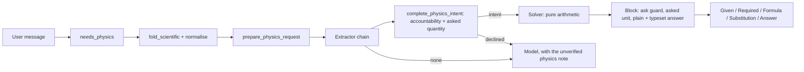

# Recall physics pipeline

Server-side extractors and pure solvers verify physics. The app shows the result; it never
solves physics on-device. A physics answer is either right, with its working, or declined to
the model, unverified. A plausible wrong number is the one outcome the pipeline is built to
prevent.

Code: `apps/api/app/modules/physics/`. Math hands physics over at subject detection
(`services/subjects/dispatch.detect_subject`) and shares no algorithm with it.

## Pipeline

1. **Gate** (`extract.needs_physics`). The gate fires on a verified template's cues, on
   advanced physics vocabulary, or on a digit-free named-body question ("escape velocity of
   Mars"). Words that are ordinary English count only beside a value of their kind:
   - "battery", "circuit" and "resistance" need an electrical value;
   - "momentum", "collision", "impulse" and "recoil" need a mass, a velocity or a force.

   A complete reading that no single law fits is a cue too: a trip in two stages, a chase
   that closes a gap, and two legs walked at right angles.

   The gate runs on every chat turn, so it is linear-time, cached per text, and reads only
   the head and tail of a long message (4,000 characters in all, up to 20,000). Every
   module-level physics regex is checked for linear time against adversarial text in
   `test_physics_detection_speed.py`.
2. **Read numbers** (`services/number_text.py`). `2 × 10^-6`, `2x10^-6`, `2·10⁻⁶` and
   `2 \times 10^{-6}` are all one number, folded to `2e-6` before anything scans the text.
   Without that, "2 × 10^-6 C" was a charge of −6 C. `numbers.py` then expands every literal
   to a plain decimal, or refuses a malformed one.
3. **Extract** (`extract.py`, `registry.py`, `extractors/`). An ordered chain of extractors
   (`registry.PHYSICS_EXTRACTORS`) runs; the first to match returns a `PhysicsIntent`. The
   order is load-bearing and commented in place. Each extractor module reads one topic; a
   topic with several named laws keeps them in a table tried in a fixed order
   (`fluid_laws.py`, `thermal_laws.py`, `modern.py`).
   Extraction reads at most 4,000 characters, and the result is cached per text.
   A trip in two stages ("reaches 11 m/s in 2.2 s from rest and holds it to the finish",
   "speeds up, cruises, then brakes to a stop") is read whole by `extractors/two_stage.py`;
   no other extractor may answer its first stage alone. `extractors/relative_motion.py`
   reads a chase (the chaser's speed is written before "chasing", the target's after it,
   and the chaser must be the faster) and two legs along compass axes ("3 km east then
   4 km north", answered with its bearing). An extractor's law whose catalog result is not
   the asked quantity gives way to the binder.
   When every extractor declines, the **binder** (`binding.py`) reads the question straight
   into a catalog operation. Its engine is subject-neutral and shared
   (`services/law_binding`: the spec types, the givens scanner, the word windows, `fit`
   and the expression evaluator); physics brings its unit table (`givens.PHYSICS_UNITS`),
   its settings (`binding_values`) and its constants (`constants.py`, named for expressions in
   `expression.PHYSICS_NOTATION`):
   - every stated value fills one input of its dimension. Two inputs of one dimension (u
     and v) are told apart by the word just before the value ("from", "to", "initial",
     "reaches") or just after it ("100 turns on the primary"). Inputs that play the same
     part (two capacitors in series) are filled in the order stated;
   - unstated inputs come from phrases ("from rest" is u = 0, "horizontally" is θ = 0,
     "string" makes a resonance n·v/2L) or settings (g; the mass or radius of the planet the
     question names; the charge or mass of the particle it names; water's c and density
     when water is the only substance named; sea-level pressure). A stated value always
     beats a setting;
   - an input that `needs_words` takes a value only when its words name it: an object's
     density is not the fluid's, a tube's diameter is not its radius, and "at 20 °C" is
     not a temperature change;
   - values listed after "and" share the words before the list ("at 100 kPa and 300 K"),
     and the words after a value stop at the first connector ("300 K is heated to 450 K"
     names 450 K, not 300 K). A rate in rad/s or rpm fills only an angular input, never a
     frequency in Hz;
   - a speed written onto c ("0.8c") is the speed of light, so relativity binds without
     the word "relativistic", and a car at 20 m/s never gets a Lorentz factor;
   - an operation's `excludes` words rule it out: a discharge is not a charging;
   - the filled inputs must be exactly a set the operation's solver answers from;
   - a law that holds only in a range says so in `requires`, expressions in its inputs that
     must come out positive. A rope steep enough to lift the crate leaves no normal force
     for friction (`m*g - F*sin(angle)`), a capacitor never discharges below zero, and an
     electron accelerated past 2% of its rest energy is not classical. Out of range, the
     law declines instead of answering;
   - light that strikes, hits or enters a medium, read alone, came from air (n₁ = 1), and
     an angle "to the surface" is 90° less than the angle of incidence. Light that starts
     inside the glass or water does not take air's index.

   Anything short of one operation with one way to fill it declines. That includes a value
   no input takes, two values for one input with no word to tell them apart, a value the
   words mark as the asked result ("reaches 18 m/s" when the speed is asked), and an asked
   word that labels a value of another kind ("my weight is 70 kg"). A binding fit is also a
   physics cue for the gate.
   Before any extractor reads the question, two kinds of sentence are read out of it:
   - **A claimed result is never a given** (`claims.py`). "I got 19.8 m/s for its impact
     speed", "my friend says it hits at 19.8 m/s" and "Does it hit the ground at 19.8 m/s?"
     state a value to check. Read as v₀, the first was answered 28 m/s; the student was
     right. The claimed value is taken out, and when the claim was the only ask it becomes
     one: the quantity it names ("What is the impact speed?"), or the kind of its unit
     ("I got 48 A" asks for a current).
   - **A side question keeps the main one on Earth** (`bodies.side_questions`). "Would it
     be different on Mars?" and "also tell me how this changes on the Moon" name a body,
     mark a comparison and state no value. Read as the setting, Mars's g answered the
     Earth question 12.2 m/s for 19.8. A body named in the main question still sets g.

   A text that asks nothing ("A ball is dropped from 80 m.") is not solved: an extractor's
   default would pick the question. Nor is a bare "what if it's dropped from 80 m?", which
   asks the thread's question again. A collision stated alone still has its one outcome.
4. **Complete** (`request.complete_physics_intent`). Every intent passes two checks before it
   is solved:
   - **Numeric accountability** (`accounting.py`). `givens.scan_givens` lists every stated number with
     its unit and dimension. A solve is refused when it leaves a stated value unbound whose
     dimension it uses — "a KE at 3 m/s and at 4 m/s" binds one speed and would answer half
     the question. A stated force, speed, length or angle of a kind the solve never uses is
     refused too: those set the situation. A 30 N push up a slope, a car's speed and the
     radius of the hump it crosses, a rolling sphere's radius were each left out by a law
     that answered another question. A length that only gives an object's size ("a 1.8 m
     tall man") is the exception. A value of any other kind is a distractor and stays
     allowed (a ball's mass in free fall). So are values the extractor derived by adding or
     subtracting givens (ΔT = 80 − 20), a count of identical resistors ("three 9 Ω
     resistors" are the 3 Ω a parallel bank binds), a direction sign, and a stated g.
   - **Asked quantity** (`ask.py`). The question's ask is read independently of the
     extractor, as dimensions, and kept on `PhysicsIntent.asked`. A quantity asked alone
     ("… amplitude 5 cm. max speed?") is an ask: unread, it was answered with the period.
     So is the unit the answer is wanted in ("in kWh", "the gauge pressure in psi at a
     depth of 10 m"), kept on `asked_unit`.
5. **Solve** (`solver.py`, `solvers/`, one module per topic). Pure arithmetic in SI, through
   Pint (`_params_in_si`). Quadratics use the cancellation-free closed form; there is no SymPy on
   the request path.

   Incline extraction retains equilibrium and kinetic motion direction. Static friction
   is the force needed for equilibrium, bounded by `mu_s*N`; it is not automatically that
   maximum. For an already sliding block, downhill-positive acceleration may be negative,
   and uphill motion reverses the friction direction. Without the moving body's initial
   speed the solver emits a force diagram rather than inventing a path from rest.

   SUVAT retains distance versus displacement. A reversal's travelled distance sums both
   portions of the path; a displacement remains signed. Its distance graph is cumulative
   and cannot decrease. Inconsistent givens and a negative elapsed time decline.
6. **Block** (`block.py`). The block refuses a result unless every asked dimension is among
   the results: a time is never the answer to "what is its speed". It converts results to
   the asked unit, then writes two spellings of the answer:
   - `canonical_answer`: plain text with real symbols (`3.97 × 10⁻¹⁹ J (2.48 eV)`), for
     guards and for readers without math.
   - `display_answer`: LaTeX with upright units (`3.97 \times 10^{-19}\,\mathrm{J}`), for
     the answer card.
7. **Respond** (`direct.py`). A complete verified request returns Given / Required / Formula /
   Substitution / Answer without waiting for the model. The law's heading holds its base
   form, then a rearrangement for the unknown as a step: `Solve for $t$`, then
   `$t = \frac{d}{v}$` (never a "rearranged for" note). A given not in SI is followed by the
   value the substitution uses (`λ = 500 nm`, then `λ = 5 × 10⁻⁷ m`). A solver that works
   in the written units (150 km in 2 h) gets no conversion row. A stated result gets one
   line above the working: "Your 19.8 m/s is right." Image questions stay on the model
   path, and so does a reply the verified result is only part of (`parts.py`): a question
   in labelled parts or several questions the result does not all answer ("(a) how long …
   (b) how fast …"), a second joined quantity ("the deceleration and the braking force"),
   a side question on another body, a yes or no about a value, and a statement with no
   question. The model writes those around the verified block, so no part is dropped.
   An instant reply that answered (b) alone left (a) unanswered. A SUVAT question in parts
   ("find (a) its final speed and (b) the distance") is answered whole.
8. **Finalize** (`fence.py`). The model's answer and visual fences are dropped, and the
   solver's are appended; the card carries the server's `verified: true` line, the only
   thing the phone draws a green check for. A reply that answers and then offers more
   ("Want the max height too?") keeps the card and scene; only a reply that asks instead
   of stating any result goes without. A final value in the prose that differs from the
   verified one (`R = 20.4 m` against `35.3 m`) gets one line above the card: "The
   verified answer is …". A model-written `simulation` is never shown on a turn without
   a verified physics block.

## Adding a law

A law the binder can read needs one catalog entry (`catalog/`) and no extractor. The
catalog is also the one list of operations: every `PhysicsIntent` is checked against it
(`catalog.check_intent`) when it is built. Each catalog file is one topic (`optics.py`,
`astrophysics.py`, `machines.py`); a new law goes into the file of its topic. An entry needs:
- `variables`, with `words`, `implied` phrases or a `fallback` where the question may name a
  value without a number;
- a `Binding`: the phrases that ask for the result, the result's unit, every set of inputs
  the solver answers from, and cue words when the numbers alone cannot show the situation
  ("horizontally", "pulley");
- `requires`, when the law holds only for some inputs: each expression must come out
  positive, or the law declines;
- for a law that is plain arithmetic, an `expression` (`"(F - mu*m*g)/m"`), with a variant
  per other input set. `services/law_binding/expression.py` evaluates it by walking a checked tree, and prints
  the rearranged formula and the substitution from that same tree. Nothing is executed,
  and nothing calls SymPy.

`test_physics_binding.py` solves every promised input set with sample values and checks the
result units the binding promised, so a binding cannot promise what its solver refuses.

An expression's answer is in SI unless every given of the result's kind shares one unit:
4 µF and 6 µF in series are 2.4 µF, and a 40 cm radius of curvature gives a 20 cm focal
length. Temperatures in °C give a temperature in °C (two waters mixed at 80 °C and 20 °C
reach 44 °C), and a change of temperature stays a change: a rise of 50 °C is 50 K, never
323 K. A question's units also carry over by context (`answer_checks._in_context_units`).
A gas stated in litres or atmospheres, a chemistry class's units, gives a volume in L and a
pressure in atm. A rate from times that share one unit is per that unit: a 5-day half-life
gives 0.139 1/day. The conversion is the last substitution row, as for an asked unit ("in
kWh"). A number written onto an element is an isotope's label, not a given ("carbon-14"). A law whose inputs are roles rather than kinds stays an extractor: Doppler
(`extractors/doppler.py`) reads who moves, toward whom, and a stated speed of sound.

A law that needs an extractor still starts as its catalog entry, which is its identity (the
`PhysicsIntent` check reads it). Then:
- the extractor goes into the file of its topic in `extractors/` and into
  `registry.PHYSICS_EXTRACTORS` at the place its order comment allows, with its cue words in
  that file's `_CUES` / `_CUE_RES` so the gate sees it;
- the solver: an `expression` needs none (`solve_expression` claims it); otherwise the kind's
  solver in `solvers/` answers the operation, and `solver._claim_solvers` refuses two solvers
  for one operation or an operation with none;
- shared readers live in `extractors/`: `stated_values.py` (a value with its unit, a labelled
  value), `unit_patterns.py`, `surface_gravity.py` and `assignments.py`; shared solver parts in
  `solvers/`: `si.py` (SI conversion, exactly one unknown), `results.py` and `arithmetic.py`.
  Use them rather than a private copy;
- a question, its look-alikes and a decline go into `stem_corpus/physics/`.

## Coverage

### Explicit symbolic models

Requests beginning with `Physics:` have a separate, whole-request grammar in
`modules/physics/symbolic/`. They run SymPy in the existing bounded worker, without
passing through heuristic numeric extraction. A malformed or unsupported model declines
as a whole. No Python code, attributes, imports, or model-authored expressions are executed.

Supported operations and examples:

| Operation | Example |
|---|---|
| Algebraic rearrangement | `Physics: solve a=F/m for a` (the stated denominator excludes zero mass) |
| Algebraic systems | `Physics: solve F=m*a; F=12; m=3 for F,m,a` |
| Simplification | `Physics: simplify sin(theta)^2+cos(theta)^2` |
| Time or spatial derivatives | `Physics: differentiate A*cos(omega*t) with respect to t` |
| Antiderivatives | `Physics: integrate 2*t with respect to t` |
| Definite integrals | `Physics: integrate k*x with respect to x from 0 to L` |
| Linear first/second-order ODEs | `Physics: ode x''+4*x=0 for x(t)` |
| Cartesian gradient/Laplacian | `Physics: gradient x^2+y^2+z^2 in x,y,z` |
| Cartesian divergence/curl | `Physics: curl [-y,x,0] in x,y,z` |
| Vector dot/cross products | `Physics: cross [1,0,0]; [0,1,0]` |
| Numeric eigenvalues/eigenspaces | `Physics: eigenvectors [[2,0],[0,3]]` |

Algebra returns explicit branches, checks substitution into every original equation,
and retains denominator conditions even when an expression cancels. Systems have up to
four equations/targets and polynomial degree at most four. Unconstrained parameterized
algebra is limited to affine equations with fixed coefficients; coefficient-dependent
rank/degree and nonlinear parameter branches decline rather than publishing a generic
root set as complete. Explicit input denominators keep their nonzero conditions.
General ODE solutions are
checked by `checkodesol`, with nonzero leading coefficients, generic discriminant
conditions for parameterized constant coefficients, and solution-generated singularities
stated explicitly. Exceptional parameter branches and parameterized variable coefficients
decline; nonlinear ODEs are outside this contract. Indefinite integrals are checked by differentiation and retain
an integration constant. Eigenvectors are checked against the matrix. Matrices are square,
of order two through four, with numeric entries; parameterized eigensystem branches decline.
Decimal source tokens are parsed exactly, including scientific notation with exponent
magnitude at most 100. Each expression is capped at 512 characters and 160 AST nodes;
the whole request is capped at 2,000 characters. Output and solve runtime are also bounded.

This verifies a **calculation on the stated model**, not the model's physical validity.
Symbols have no inferred dimensions, sign, reality, or particle identity. Complex solutions
remain explicit. Unit-bearing word problems continue to use the catalog/Pint pipeline.
An unevaluated integral, unresolved derivative, unsupported request, or timed-out solve
stays unverified. The symbolic path does not invent a scene from an arbitrary equation.

The detailed coverage audit and outstanding advanced capabilities are recorded in
[PHYSICS_REVIEW.md](./PHYSICS_REVIEW.md).

### Backend solver coverage

The binder reads these laws, beside the extractors' own:

| Area | Laws |
|------|------|
| Motion | SUVAT for v, s, t, a and u, including s = vt − ½at²; d = vt in any units; fall height; horizontal launch; rocket Δv; center of mass of two or three stated point masses |
| Forces and energy | W = mg on a named body; Atwood; applied force with friction; static-friction sliding threshold on an incline; P = mgh/t; energy-conservation speed; Kepler period; vis-viva speed when the semi-major axis is stated; rotational KE; θ = (ω₀+ω)t/2 |
| Circuits | Q = It for I; Q = CV for Q, C and V; R = ρL/A; τ = RC; RC charging and discharging; capacitors in series and parallel; ideal-transformer voltage and current; parallel-plate capacitance with a stated dielectric; coaxial capacitance; a spherical capacitor; drift speed; mutual inductance; tan φ = (X_L − X_C)/R; average AC power when the phase angle is stated; quality factor from bandwidth or from series L, C, and R; capacitor energy U = Q²/(2C) and U = QV/2 |
| Fields | E = V/d between plates; F = qE; W = qV (eV with "in eV"); solenoid B = μ₀NI/L; loop center and toroid B; solenoid self-inductance; cyclotron frequency; Hall voltage; electric and magnetic energy densities; magnetic moment μ = IA and τ = μB sinθ when the angle is stated; force per unit length between two parallel wires; electric dipole field on its axis; skin depth from conductivity or resistivity |
| Waves and optics | resonance of a string or pipe; speed of sound in an ideal gas from γ, P, and ρ; thin-film thickness for constructive or destructive reflection at normal incidence; Snell for θ₂; diffraction grating angle; lens power; lenses in contact; lens-maker focal length; telescope angular magnification; compound-microscope magnification when the tube length and near point are stated; Rayleigh criterion; mirror f = R/2; magnification m = −v/u; electromagnetic-wave intensity; plane-wave intensity I = P/A; E = cB and B = E/c; Poynting magnitude EB/μ₀; longitudinal rod speed from Young's modulus; shear-wave speed; numerical aperture; grating resolving power R = mN |
| Thermal | PV = nRT for any unknown; PV = NkT for any unknown; ideal-gas density ρ = PM/(RT); Boyle, Charles, Gay-Lussac and the combined law; Q = mcΔT for any unknown; water mixtures; latent heat; linear, area and volume expansion; isothermal work; mean free path; v_rms, mean and most probable speed; ⟨E_k⟩ = 3/2 kT; diatomic U = 5/2 nRT; adiabatic T V^{γ−1}; Mayer's relation C_p − C_v = R |
| Fluids | absolute pressure; apparent weight when submerged; floating fraction; capillary rise |
| Modern | photon momentum; threshold frequency and wavelength; stopping potential; photoelectric KE; fraction and mass remaining; decay constant; activity; mean life; net blackbody power P = εσA(T^4 − T_0^4) |
| Upper level | hydrogen transitions (λ and ΔE); hydrogen-like levels E = −13.6 Z²/n² eV when Z is stated; Bohr radius; hydrogen-like radius n²a₀/Z; Bohr L = nℏ; L² = ℏ²ℓ(ℓ+1); L_z = mℏ; normal Zeeman shift; pair-production threshold; quantum-oscillator levels; relativistic p, E and K; E² = (pc)² + (mc²)²; velocity addition; Lorentz transformation of one coordinate and of one time; Schwarzschild radius; gravitational time-dilation factor; Boltzmann ratio; S = k ln Ω; energy-time uncertainty; an orbit's period from its height; Fermi energy; Fermi-Dirac and Bose-Einstein occupation; Planck's law as spectral radiance; rectangular-barrier tunneling probability; Drude conductivity; Hall coefficient; nuclear radius R = R₀ A^{1/3}; Hawking temperature; Hawking power; Bekenstein-Hawking entropy; stellar luminosity; flux from a stated luminosity; Hubble's law; critical density; Friedmann Hubble parameter when density, curvature, scale, and Λ are stated; virial K = −U/2; plasma frequency; Debye length; Alfvén speed; sound speed from the bulk modulus; quadratic drag force from C_D; BCS gap; Higgs mass; one-loop strong coupling |
| Round 3 | light travel time; gravitational force on a body at a named planet's surface; acceleration and net force from two opposing forces; recoil speed; push-off speed of either body; wave frequency from distance, time and wavelength; sound level from an intensity ratio; energy over days from a daily use |
| Sweep additions | time to the top of a throw; a level launch off a table or cliff; echo distance vt/2; hydraulic lift with the load on the large piston; mass from F and a; average force from a speed change; terminal drag; weight along a slope; drop speed from a height; speed from kinetic energy; work against gravity; efficiency in percent; spring compression from speed; current from power; charge and energy from Q and V; point-charge field; force on a moving charge; spring constant from a hanging mass or a force; pendulum length from its period; frequency and period from a count; string tension in a horizontal circle; critical angle to air; focal length from lens power; pressure from a weight on an area; water pressure at a depth; upthrust on a fully submerged volume; surface gravity on a named planet; E = mc² |
| Round 5 | time for two bodies heading toward each other to meet, d/(v₁ + v₂); a block on a frictionless table pulled by a hanging mass, a = m₂g/(m₁+m₂) and T = m₁a; a force along an incline, a = F/m − g(sin θ + μ cos θ); speed on a circle from its period, 2πr/T; a rolling sphere's, cylinder's, hoop's or shell's total kinetic energy; a spring's maximum speed Aω and acceleration Aω²; g a height above a named body, GM/(R + h)²; the normal force over a hump, m(g − v²/r); a string's tension at the bottom of a vertical circle, m(v²/r + g) |
| Investigation | a pull at an angle with kinetic friction, a = (F cos θ − μ(mg − F sin θ))/m, and a push down at an angle; a constant-velocity push μmg; the tension in a tow bar, m·a; a speed change from a force over a time; scales in a lift reading N; perpendicular velocities added, √(v₁² + v₂²) (a boat across a river, a plane in a crosswind); a two-stage trip's distance or time; a stopping distance with a braking rate; a chase's catch-up time; two legs' displacement and bearing; a level launch speed d√(g/2h); Snell with light from air and an angle to the surface; the critical angle between two media; wavelength in a medium; an image's height (inverted when real); a virtual image's distance as its size and side; a mirror image from a radius; a double slit with its words; collision energy lost; an explosion's second fragment; a rebound's average force; Torricelli's outflow; Bernoulli's pressure drop; a hydraulic lift and continuity from diameters; a volume from an apparent weight; a pendulum's frequency; a mass from a spring's period; sound intensity from a point source; the speed of sound in air at a temperature; a wave's travel time; decay time from a fraction ("1/16 of"); percent and fraction after n half-lives; a half-life from two activities; time dilation with "speed of light"; force from power and speed; lift time with an efficiency; pump power; spring launch speed; energy lost in a bounce; work-energy speed, from rest or a moving start; a pendulum's bottom speed; weight at a height; orbit radius from a period; angular momentum conservation; current with internal resistance; energy from power and time; resistance from power; capacitor discharge time to a voltage; heating time from a power; linear expansion between two temperatures; refrigerator COP from heats; photoelectric max KE; a photon's energy from its wavelength; photons per second, Pλ/(hc); de Broglie wavelength after acceleration through V, h/√(2mqV); E = mc² for mass lost in a reaction |
| One formula | physical and conical pendulum periods; torsional pendulum; thin rod about its center or one end; springs in series and in parallel; reduced mass; coefficient of restitution; gravitational fractional frequency shift; decay time from N₀ to N; speed to just complete a vertical loop; sound level; shear, bulk and Poisson; gear speed and gear ratio; Newton's law of cooling; absorbed or reflected radiation pressure; Otto efficiency |

## Numbers and units

- **Answers** have three significant figures, trailing zeros trimmed. Scientific notation is
  used outside [10⁻³, 10⁵), and rounding comes first: 99999.7 is 1 × 10⁵. One formatter does
  this, `display.py`; a solver never picks its own format. A 5 rounds up, as a class rounds:
  490.5 N is 491 N (`services/school_rounding.py`, the rule every subject shares).
- **Givens** are echoed with the figures the user typed, up to six. A given is never rounded
  to answer precision.
- **Constants** (c, e, mₑ, h, G, ε₀, …) are CODATA values from Pint, read once in
  `constants.py` and pinned by a test; no solver or extractor types one. A binder substitution
  prints a constant to six figures (`expression.PHYSICS_NOTATION`). The one 273.15 is
  `services/units.CELSIUS_OFFSET_K`, shared with chemistry.
- **Units** are upright, with their symbols: m/s², kg·m², J/(kg·K), Ω, °. In LaTeX the unit
  is a `\mathrm{…}` run holding that plain spelling, because MathText draws a `\mathrm` group
  as written.
- **Working rows** never show calculator notation: `6.6261e-34` is typeset as
  `6.6261 \times 10^{-34}`.
- **Energy from a power and hours or days** is answered in joules with the kilowatt-hours
  beside it, as a bill writes them: 100 W for 5 hours a day for 30 days is
  5.4 × 10⁷ J (15 kWh).
- **Everyday spellings** are read before any extractor: "accelaration", "velocty" and
  "whats"; kph and kmph as km/h; °F, whose change is worked in kelvins, never as a raw
  °F difference; mAh and Ah; weeks; µs and ns; amu, and a bare "u" written
  apart from its number before "of" or the end of a sentence ("0.003 u of mass"), never
  "2u" or "u + at"; photons/s; "1/16 of" as an exact fraction (denominators of 2s and 5s
  only); "for a week" as one week. "How many kWh" asks in kWh, but "how many moles" is a
  count, not an asked unit.
- **A law's own unit** ("photons/s", "Bq") is printed as the law names it, never as the
  unit of a like given: a photon rate beside a frequency is not in Hz.
- **A price is not a given.** "$0.15 per kWh" or "costs 12" is read past, so it never fills a
  variable.
- **Scene labels** are formatted from the true values. Re-rounding a label that a solver had
  already rounded put 59.0 N on the picture beside a 59.1 N answer.
- **Scene coordinates** retain their floating-point precision instead of rounding to fixed
  SI decimal places. Micrometre orbits keep their shape. Vertical launches receive padded
  horizontal bounds, and static scene bounds include vector anchors and endpoints in all
  quadrants. Height diagrams place the body above the ground by the stated height.

## Pictures

A verified answer carries at most one picture, a `simulation` fence (schema v2,
`schemas/simulation.py`). The server samples every position and every frame. The phone walks
the samples and never re-derives motion. Two kinds of picture exist:

- **Scenes** have bodies on one clock. They cover projectiles and falls (with the ledge, R, H and
  θ marked), inclines, free-body boxes, Atwood machines, levers, vector sums, orbits (with the
  planet to scale), circular motion on a string, springs, pendulums, collisions, recoils and
  charges. v2 adds:
  - box bodies;
  - tethers and a pulley;
  - a central body;
  - angle arcs;
  - solids and fluids;
  - labels on the derived arrows (`mg = 49.1 N`);
  - strobe ghosts;
  - vectors that ride on a body.
- **Diagrams** have no bodies. The phone lays them out from the spec:
  - `circuit`: a source and a load of parts, series or parallel groups. A network is drawn
    as the question states it: every resistor, its group's total as the group's label and,
    when the current is asked, the battery and the current it drives. It is never one
    equivalent resistor;
  - `rays`: lenses, mirrors and an interface, with rays traced here;
  - `wave`: frames of displacement over fixed samples, with nodes, antinodes and the ends that
    hold the wave.

  A diagram draws only measure lines and carries no moving bodies, and the schema refuses
  either.

Every picture has an `alt` sentence for screen readers and a `title_key` the phone translates.
An unknown key falls back to the English `title`, so a newer server never blanks an older app.
Fields a scene does not use are left out of the JSON, so a stored v1 reply serialises as before.

A solver that knows its situation draws it: `motion_scenes.py`, `force_scenes.py`,
`circuit_scenes.py`, `optics_scenes.py`, `wave_scenes.py` and `field_scenes.py`. A catalog law
solved as arithmetic has no solver to draw it, so `solvers/catalog_scenes.py` looks the picture
up by operation and reuses the same builders. A string's tension is the circular scene with
its string, and a recoil is the collision scene started from rest. An operation not listed
draws nothing.

A request to see the forces on a body ("draw the forces on a box sliding down a 30°
incline with friction", "show the forces on a hanging mass") needs no number: when nothing
solves, `force_pictures.py` reads the situation (an incline, with a push, a rope or sliding up
it, friction against the motion; a hanging body, a body in the air, a box on a level surface
pulled or pushed) and draws its free-body diagram with symbol labels (mg, N, f, T, F) and only
the angle the user gave (θ otherwise). `force_rigs.py` adds two masses over a pulley, a block on
a table pulled over a pulley by a hanging mass, a car on a flat or banked curve seen from behind
(its acceleration a toward the centre, never a separate "centripetal force"), and a ball on a
string at the top or bottom of a vertical circle. The turn carries that picture and no result:
no card, no number. A plain-text sketch the model drew beside a server picture is removed. A
situation neither knows (a pulley on a slope, a cart in a loop of track, two ropes, a spring)
draws nothing.

Where one formula covers different apparatus, a hidden variable that only the picture reads
says which one it is:
- `pipe`: an open pipe and a string share n·v/2L, but a pipe's open end is an antinode;
- `mirror`: a concave mirror and a lens share 1/f = 1/u + 1/v;
- `free_fall`: the speed at the bottom is path-free, but a roller coaster drawn as a straight
  drop shows the wrong motion.

## Clients

`docs/fixtures/physics_replies.json` holds real direct replies and the plain answer each
carries. Three tests read the file:
- `test_physics_reply_contract.py` proves the server still writes those replies. Regenerate
  with `UPDATE_PHYSICS_FIXTURE=1` to accept an intended change.
- The web test (`physicsReplyContract.test.ts`) proves the answer card reads as the plain
  answer on a page with no math renderer (`answerNotation.readableLatexAnswer`).
- The mobile test (`physicsReplyContract.test.ts`) proves copy and read-aloud carry the
  answer, and that `30^\circ` reads as thirty degrees.

## Scanner

A photographed problem goes through the same pipeline as a typed one.

1. The camera's physics tab sends the crop to `POST /physics/scan/read` (`api.py`). The shared
   guard in `services/scan_read.py` checks the payload, the vision spend cap and the per-user
   rate, as it does for math and chemistry.
2. `read.py` asks `vision-chat` for the problem as written, then turns any LaTeX into the text
   a student would type: `2 \times 10^{-6}\,\mathrm{C}` becomes `2 × 10^-6 C`, `30^{\circ}`
   becomes `30°`, and `\mu` is µ before a unit and μ elsewhere.
3. The student checks the reading under **I read this as**, then chooses:
   - **Solve** sends the text alone, so it gets the verified Given / Required / Formula /
     Substitution / Answer reply of a typed question;
   - **Send photo** sends the crop with `I read this as: …`. The turn verifies that reading
     (`modules/physics/subject.py`, `_physics_request_text`), and the model writes the reply, since the
     photo may hold a diagram the text does not.

A physics caption is physics, never math: math neither OCRs the photo nor claims the
confirmed reading. A photo with no reading gets the unverified physics note.

## Quality bar

`app/tests/modules/physics/corpus.py` holds school questions with hand-worked answers
(g = 9.81 m/s², CODATA constants), must-decline traps, and non-physics negatives.
`test_physics_corpus.py` asserts three things:
- a verified answer always matches its expected value;
- traps decline and negatives are not physics;
- coverage never falls below `COVERAGE_FLOOR`.

The **STEM sweep** (`app/tests/behavior/stem_sweep.py`) checks the whole chat path, not just
the solver. `stem_corpus/physics/` holds 753 turns: textbook questions across 19 areas,
everyday look-alikes, questions that must be declined, `holdout.json`, written after the
fixes below so the coverage number stays honest, `investigation.json`, the September
investigation's 286 questions (multi-part ones list every `parts` value the card must
hold), and `investigation_lookalikes.json`, the everyday sentences its new readers must
leave alone. For each turn it routes the prompt as a
chat turn does and reads the verified answer card (1% tolerance, any unit of the same kind).
It also checks the reply's Given / Required / Formula / Substitution / Answer order (an older
reply's Find counts as Required), flags
calculator notation and an invented zero given, and validates every `simulation` and `graph`
fence against the schema and its own bounds. `test_stem_sweep.py` fails on a wrong number, a
misread turn (a physics question answered as math, or hijacked by a location or settings
reply), a reply out of shape or a broken picture. It holds coverage entry by entry
(`stem_snapshot.json`): 609 of 625 answered, and 193 of 194 with the picture a student would
want. Only a
`projectile_motion` scene beside a path graph (x–y or height–time) counts as the same
picture twice; a v–t graph beside a fall says something the fall does not.

    uv run python -m app.tests.behavior.stem_sweep physics --show

The first run found five wrong verified answers, each now in
`test_physics_sweep_regressions.py`:
- "how long must the runway be" was answered as a time;
- "how long until it reaches the top" was the whole flight;
- a ball rolling off a table was timed as d/v;
- an echo's distance was not halved;
- a hydraulic lift put the car's weight on the small piston.

It also found 17 textbook questions the solver did not recognise; these are now catalog laws.
The nine it still left to the model (recoil, push-off, opposing forces, a decibel ratio,
energy over days, a frequency from d/t and λ, light travel time, gravity at a planet's
surface, two equal charges) are answered now. Their questions and look-alikes are in
`round3.json`.

A fifth round (`round5.json`) put 286 fresh questions through the chat path and found 37
verified answers that were wrong, numbers given to questions that must decline, or parts
dropped. 28 are answered right now and nine declined; none is wrong. Among them: a throw
"straight down" read as up, "30° below the horizontal" read as above, a horizontal throw
with no height timed as a throw up, two trains' speeds read as one train's u and v, a block
on a table solved as an Atwood machine, a push up an incline left out, a radius taken as a
turn's distance, a rolling sphere's spin left out, a spring's "max speed?" answered with its
period, series and parallel resistors summed as series, "three 9 Ω resistors" read as one,
boiling water answered with its warming alone, a height above Earth read as its radius, a
hump's normal force taken as mg, a student's own answer used as a given, a side question's
planet used for the main question, and a question in parts answered one part at a time.
Each is in `test_physics_sweep_regressions.py`.

The September investigation's four strict gaps are closed, each routed to physics and
verified: a river crossing's resultant speed (it was searched on the web), a two-stage
sprint, a pull at an angle with kinetic friction, and refraction with the angle given to
the surface (maths claimed the last three). Its missed clusters are answered too:
momentum (explosions, energy lost, rebounds, bodies named in the ask), optics, a spring's
maximum speed and acceleration, fluids, decibels, a half-life to 1/16, time dilation,
two-stage trips, chases and right-angle legs, and photon, de Broglie and mass-defect
energies. The sweep went from 468 to 574 of 597 answered with no wrong number, and it
found two wrong verified answers on the way, both now declined or answered whole: a
two-stage trip answered as its first stage, and "how many photons per second" answered
with one photon's energy. The laws and their near misses are in
`test_physics_investigation_gaps.py`; the everyday look-alikes are in
`sweep_corpus/physics_investigation.json`.

Still left to the model, by design or for now: series-parallel networks other than one
resistor in series with a parallel group (that one is read, solved and drawn nested, from
`extractors/series_parallel.py`), heating through a phase change, a lap's average velocity (zero, not d/t), Doppler with both parties
moving, multi-part questions that need several laws, a plank balanced with its own weight
at the pivot, and a string's tension at the top of a vertical circle.

## What it refuses

A refusal is a decline to the model, labelled unverified, never a guessed number. The
pipeline refuses:
- a question longer than 4,000 characters (it still gets the physics note);
- a number it cannot read whole;
- a stated value of a kind the solve uses, left unbound, and a stated force, speed, length
  or angle of a kind it never uses;
- a statement that asks nothing, and a "what if …" that names no quantity;
- a fall with no stated height (a horizontal throw, a roll off a table, a throw down a well),
  except a throw straight up that comes back to the hand; a throw whose direction is unsaid;
- a chase whose chaser is not read or is the slower, a series-parallel network of any
  other shape ("in parallel with both" is (R₁ + R₂) ∥ R₃, not R₁ + (R₂ ∥ R₃)), heating
  through boiling or melting, the average velocity of a lap, and a downward launch's peak
  height;
- a trip in two stages answered for one stage, two legs that are not along compass axes
  at right angles, and the total path walked, which is not a displacement;
- a law outside its `requires`: a pull that lifts the block, a motor more than 100%
  efficient, an electron accelerated past 2% of its rest energy;
- a count of photons over a stated time;
- a result whose kind is not the asked one, and a price ("find the cost"), which no law
  answers;
- a Doppler speed with no direction, or one speed when both parties move;
- a magnification from a virtual image's distance, or a convex mirror's focal length, whose
  sign the conventions disagree on. A virtual image's distance itself is answered as a
  size and a side ("virtual, on the object's side of the lens"), with no sign to disagree
  on;
- values listed "respectively" for inputs told apart by words ("primary and secondary coils
  with 100 and 500 turns respectively"); a list the law fills in order still binds;
- every refusal listed under Physics in `FEATURES.md` (an unstated collision type, a
  diverging lens, an absolute temperature written as bare "degrees", and the rest).
