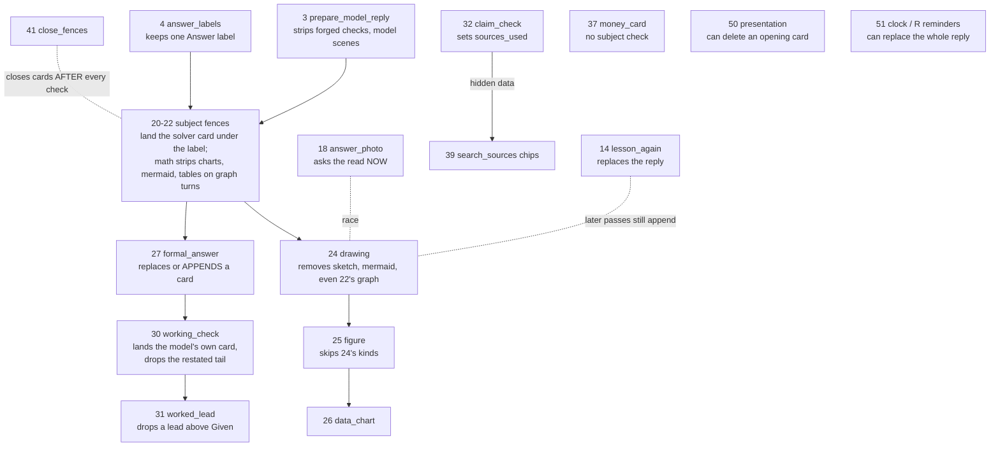

# Review: the finalize pipeline (2026-11-19)

**What this covers.** What happens to a reply between the model's last token and what the student
sees. Read from `origin/main` at ff032687, with the four open PRs (#2496, #2499, #2500, #2501) read
beside it. No app code is changed here. The only code added is
`apps/api/app/tests/review/test_finalize_conflicts.py`: 12 probes, each of which runs a reply
through the real `enrich_final_content` and asserts a defect. They are skipped unless
`RECALL_REVIEW_PROBES=1`, and every one passes (reproduces) on main.

Paths are `apps/api/app/modules/chat/…` unless they start with `app/`.

## Summary

- **Scale:** 52 named passes run in a fixed order (`finalize_passes.py:191-357`), then the reminder
  pass. The pass modules and their `*_turn.py` feeders are about 7,700 lines, before the subject
  fence code they call.
- **Defects come from ownership, not order.** Each student-visible thing is decided by several
  passes that don't know about each other:
  - the answer card has five placers;
  - which model picture yields to a server picture has five rules;
  - an open fence is repaired in five places;
  - the note lines under a reply have four writers.
- **Conflicts reproduced:** 12, all on the real finalize path (section 3). Among them:
  - a right card replaced by a wrong one;
  - a card left contradicting its own working;
  - a model card that skipped every check because it was still open when the checks ran;
  - a car-loan card under a physics answer;
  - a flowchart kept in place of a ray diagram;
  - "Here is the v–t graph" left above a stripped graph.
- **The open PRs:**
  - #2501 fixes the replaced card.
  - #2500 fixes the flowchart when the turn's read is in.
  - Neither touches the other ten.
  - #2500 and #2501 each add one new hazard. #2499 and #2500 each fix the summary's picture record
    with a different table and marker, and they don't compose (section 3.2).
- **Most passes have no corpus evidence:** 29 of the 52 changed nothing on any of 7,446 corpus
  turns, mostly because the offline harness can't reach them. A behaviour-free migration therefore
  needs the corpus extended first (section 5, PR 0).
- **Proposal:** four stages with one owner per thing — normalise, the server's facts, prose
  polish, a last guard. The migration is nine small PRs, each proven with the decision diff, and
  should remove about 1,500 lines (section 5). The five changes worth most are in section 6.

## 1. The map

### 1.1 Run order and what each stage touches

```
 1 control_tokens ─ 2 drop_cut_reminder_fence ─ 3 prepare_model_reply ─ 4 answer_labels
 5 untrusted_media* ─ 6 search_links
 7 generic_closer ─ 8 praise_opener ─ 9 meta_notes ─ 10 prompt_leaks ─ 11 repeated_fences
12 self_attribution ─ 13 turn_meta ─ 14 lesson_again ─ 15 option_letters ─ 16 name_use ─ 17 emoji_use
18 answer_photo* ─ 19 reply_picture*                                 (pictures I: photos)
20 chemistry_fences ─ 21 physics_fences ─ 22 math_fences* ─ 23 formula_charts   (cards + pictures II)
24 drawing* ─ 25 figure* ─ 26 data_chart* ─ 27 formal_answer*               (pictures III, card II)
28 server_answer_cards ─ 29 unverified_notes ─ 30 working_check ─ 31 worked_lead  (card III, notes)
32 claim_check* ─ 33 text_plots ─ 34 solve_markers ─ 35 chemistry_enrich
36 settings_card* ─ 37 money_card* ─ 38 request_sections ─ 39 search_sources* ─ 40 instant_usage*
41 close_fences ─ 42 clarify_card* ─ 43 new_practice* ─ 44 lesson_shape*
45 requested_json ─ 46 recipient_placeholders ─ 47 prose ─ 48 mermaid_and_places ─ 49 proper_case
50 presentation ─ 51 clock ─ 52 worked_language ─ R reminders
(* EFFECT: commits the text, so a later failure falls back to it)
```

**The open PRs:**
- #2501 moves 27 `formal_answer` to after 31 `worked_lead` and adds `card_numbers` after it.
- #2500 adds `owed_picture` after 41 `close_fences`.
- #2496 and #2499 add no pass. #2499 feeds `ctx.followup_problem`, which 24 reads, and both #2499
  and #2500 change the summary input (`compaction.py:113`).

### 1.2 Dependency graph: what reads another pass's output, and what undoes what



- **Undo edges, every one cited in the tables below and in section 3:**
  - 22 → model charts and tables;
  - 24 → 22's canonical graph;
  - 27 + 30 → two cards;
  - 21 (unverified) → the model's own card;
  - 28 → solver scenes on an uncertain photo;
  - 37 → any `calculator` fence on any turn;
  - 50 → an opening card;
  - 51 and R → the whole reply;
  - 14 → the whole reply, with later passes still appending.
- **The hidden data edge:** 32 → 39, guarded only by `before=` (`finalize_passes.py:313`).
- **The race:** 18/19 read the turn's live read at pass time (`drawn_picture.py:103`, which never
  waits), and 24/25/27 read it later. A read that lands in between gives a photo *and* a drawn
  picture.


## 2. Ownership: who decides each thing the student sees

"Owners" are the passes that may add, remove or rewrite the thing. One owner is the target.

| what the student sees | owners on main | count | with the PRs |
|---|---|---|---|
| **Answer card: whether it exists, where, its value** | 4 `answer_labels`, 20–22 subject fences (`land_answer_card`), 27 `formal_answer` (replace, or **append**, `formal_turn.py:209-212`), 30 `working_check` (lands the model's own), 31 `worked_lead` (drops a lead stating it), 50 `presentation` (`drop_orphan_leading_answer`, `presentation.py:43`) | **6** | #2501: 27 never appends and moves after 30–31; adds `card_numbers`. Still 6 |
| **Answer card: number format** | the subject fences (each subject's own), `worked_figures`, 50's `layout_calculations` (`calculation_layout.py:66`) | 3 | #2501 adds `card_numbers`, which skips unclosed fences: **4** |
| **Answer card: ✓ / "not checked" header** | 3 (strips forged markers), 20–22 (`verified: true`), 28 `server_answer_cards` (`uncheck_cards`) | 3 | same |
| **A picture (graph, scene, figure, chart, photo)** | model fences, 3 (strips model scenes), 11 (model repeats), 18 photo, 19 generated picture, 21 physics scenes (+`without_model_drawings`), 22 math canonical graph (+strips chart/mermaid/tables), 23 formula charts, 24 drawing (+`without_drawn_substitutes`), 25 figure (+`without_substitutes`), 26 data chart (+`placed_charts`), 28 (deletes scenes), 35 chemistry structures, 48 (mermaid sanitize) | **13** | #2500 adds `owed_picture` (removes a stand-in flowchart, says "couldn't draw"): 14, behind one gate (`read_lets`) for some of them |
| **Which model picture yields to a server one** | 21, 22, 24, 25, 26: five rules | **5** | #2500 adds a sixth (`owed_picture` on flowcharts) |
| **A note line under or over the reply** | 29 `unverified_notes` (chemistry's note), 30 `working_note`, 27 provenance line, 32 claim-check note, 45 `JSON_INVALID_NOTE`, 21 `correction_line`, 22 "diagram dropped" | **7** | #2501 adds a contradiction line and "replaced" lines; #2500 "I couldn't draw…"; #2496 a phone-side cut-off note: **10** |
| **Closing line** | 7 `generic_closer` (strips), 21 and 30 (`drop_restated_tail`, `worked_lead.py:274`), the prompt (asks for one) | 3 strip, 0 guarantee | #2500 appends a line in that area |
| **Emoji** | 17 `emoji_use` (+ the phone's `emojiPlacement.ts` for the draft, fixture-held) | 1 + twin | same |
| **Fences being whole** | 2, 3 (drops open model scenes), math `replace_unclosed_graph_fence_safe` (`math/fence.py:84,130`), physics (`physics/fence.py:224`), chemistry (`chemistry/fence.py:392`), 41 `close_fences` | **6** | same |
| **Trailing whitespace** | 18 (`answer_photo.py:71` `.strip()` with no photo), 29 (`unverified_note.py:58` `.strip()` on every reply), 20–22 (re-add), 47 | 4, none on purpose | same |
| **Money card** | 37 (strips every `calculator`, adds on `MONEY.owns`), turn prep's money read decides | 1 pass, decided at prep with no subject check | same |
| **Settings card** | 36 | 1 | same |
| **Clarify card** | 42 | 1 | same |
| **Source chips** | 32 (`sources_used`), 39, 5 (drops a model `sources` fence) | 3 | same |
| **Practice and quiz cards** | 43 `new_practice` (model call), 44 `lesson_shape` (model call; `unnumbered_practice` on every reply) | 2 | same |
| **The whole reply replaced** | 14 `lesson_again`, 22 (`direct_reply` on a hint turn, `math/fence.py:405`), 51 `clock`, R (`todo_screen_answer`) | **4** | same |
| **The summary's record of pictures** | `compaction.py:113` through `strip_prompt_owned_fences` (`prompt_window.py:140-154`): picture fences reach the summary model as raw JSON, or not at all | 1, wrong | #2499 and #2500 each replace it, with different tables and markers |

**Every row with more than one owner is a place two passes decide the same thing.** The
reproductions in section 3 sit on the answer-card, picture, note, closing-line and fence rows.

## 3. Conflicts and ordering hazards (reproduced)

`app/tests/review/test_finalize_conflicts.py` builds the turn the way the behaviour harness does
(`route_case`), runs the model reply through `enrich_final_content`, and asserts the defect.
Each test passes on main, meaning the defect is there.

```
RECALL_REVIEW_PROBES=1 uv run pytest app/tests/review/ -q   # 12 passed
uv run pytest app/tests/review/ -q                          # 12 skipped (CI)
```

### 3.1 On main

| # | test | the conflict | reply in → what ships |
|---|---|---|---|
| 1 | `test_conflict_1_formal_answer_replaces_a_right_card` | 27 `formal_answer` (`formal_turn.py:156-201`) against the reply's own card. Maths dispatched the turn while the read says physics | the model's right 250 Pa, worked with the question's g = 10, becomes the formal 245.2 |
| 2 | `test_conflict_2_formal_card_under_working_that_says_otherwise` | 27 against 30 `working_check` | a 2 A card under working that still ends "I = 3 A" |
| 3, 3b | `test_conflict_3_demoted_card_left_as_a_bare_line` (+ Amharic heading) | 22 `rewrite_answer_fences` demotes the model's card on an unsolved turn (`math/fence_conflict.py:175`), and 30 re-lands only working it recognises | the answer as a bare line where its card was. The closest reproduced shape to the incident's orphan "1.03 × 10⁵." line |
| 4 | `test_conflict_4_stripped_graph_leaves_its_lead` | 22 strips a ```graph no solver wrote (on a physics turn too), and no pass owns the sentence that introduced it | "Here is the v–t graph of the car's motion:" over nothing |
| 5 | `test_conflict_5_loan_card_under_a_physics_answer` | 37 `money_card` checks only `MONEY.owns` (`finalize_money.py:24-35`), never the turn's subject | "A car accelerates at 6% of g…" gets a car-loan calculator |
| 6, 6b | `test_conflict_6_open_card_ships_unchecked_on_a_solved_turn` | every subject fence pass reads closed fences only; 41 `close_fences` closes them afterwards | on a solved turn the model's wrong 18 J ships, and the verified 9 J never appears |
| 7 | `test_conflict_7_closing_summary_dropped_by_two_owners` | 21 and 30 (`drop_restated_tail`) both drop the last paragraph | the one-line closing summary the owner wants is gone. It's dropped as a pure restatement, which the code documents as intended. The owner's rule says keep one line |
| 8 | `test_conflict_8_flowchart_kept_for_a_ray_diagram` | 48 keeps (sanitises) a Mermaid stand-in; no picture pass asks whether it answers | a flowchart in place of a ray diagram |
| 8b | `test_conflict_8b_flowchart_beside_the_server_figure` | 24/25 add the server's ```geometry, and nothing removes the model's flowchart | both pictures |

**Not reproduced; claimed nowhere in this report:**
- the incident's exact "1.03 × 10⁵." orphan line, under sentence, colon, parts and
  restated-tail variants;
- a "graph this" data chart stripped: 26 needs the read, which the offline harness doesn't
  have;
- a money card on a physics follow-up after an earlier loan: the money read didn't claim those
  lines.

### 3.2 What the four open PRs do to these

Each probe was run in a worktree of each PR, and of #2500 and #2501 merged together:

| # | #2496 | #2499 | #2500 | #2501 | #2500+#2501 |
|---|---|---|---|---|---|
| 1 | repro | repro | repro | **fixed**: no card replaced. But the card stays demoted to "250 Pa" (= #3) | as #2501 |
| 2, 3, 3b, 5, 6, 6b, 7 | repro | repro | repro | repro | repro |
| 4 | repro | repro | repro, **and newly** "I couldn't draw this graph." under "Here is the v–t graph…" | repro | the same contradiction |
| 8 | repro | repro | fixed **only when the read is in**; without it, repro | repro | as #2500 |
| 8b | repro | repro | repro without a read | repro | repro |

**New hazards the PRs introduce** (probes in the scratchpad, not in the repo file):
- **#2501's `card_numbers` runs before `close_fences` and skips unclosed fences.** An unclosed
  card ships as "v = 13.333333 m/s" while a landed one is rounded to 13.33. One rule, two outcomes.
- **#2500's `owed_picture` against 22's strip.** The reply says it shows a graph, then says it
  couldn't draw one (row 4).
- **#2499 against #2500 on the summary:**
  - Both replace `compaction.py:113`.
  - #2499 uses `summary_text`, marks pictures `[shown: a graph]`, calls mermaid a "diagram", and
    adds vega, plot, photo and chem_scene.
  - #2500 uses `pictures_named`, marks them `[graph shown]`, and calls mermaid a "flowchart". Its
    table also disagrees with its own `APP_PICTURES`.
  - #2499's new `SUMMARY_SYSTEM_PROMPT` line recognises only `[shown: …]`. A merge that keeps
    #2500's function with #2499's prompt records every picture as not shown, which is the
    incident again.
  - They also conflict textually in `compaction.py`.
- **#2496 against #2500:** traced, not reproduced. A reply cut at the length limit isn't marked
  cancelled (`stream_accum.py:95`), so it runs every pass, and can save "I couldn't draw this
  graph." while the phone shows its own cut-off note.
- **All four PRs** conflict pairwise in `tests/modules/chat/test_prompt_rule_text.py` (snapshot
  numbers).
- **#2500 + #2501's merged pass order** passes `test_finalize_passes.py`. `owed_picture` declares
  `after formal_answer`, which #2501 moves but keeps before `close_fences`.

## 4. Duplication and dead weight

### 4.1 One job done in several places

**Server against server:**
- **Open-fence repair, in five places:** `drop_cut_reminder_fence`; the maths
  (`math/fence.py:84,130`), physics (`physics/fence.py:224`) and chemistry
  (`chemistry/fence.py:392`) repairs; and `close_fences` (`services/md_fence_scan.py:451`).
  Hazard 6 is the cost: `after=FENCE_READERS` puts the general closer after the checks it should
  feed.
- **Placing the answer card, in five passes:** see the table in section 2. Three of the
  reproductions sit here.
- **The note under an unchecked answer, from two passes:** 29 `unverified_notes`
  (`finalize_subjects.py:278`) and 30 `working_note` (`:301-306`), each unaware of the other.
  Physics states its note in the prompt, a third channel.
- **Trailing whitespace, with three accidental owners:** `answer_photo.py:71` and
  `unverified_note.py:58` each `.strip()` every reply, and the fence passes add a newline back.
  Every STEM trace therefore lists `answer_photo` (1,988 turns) and `unverified_notes` (723
  turns) as changed when nothing changed. That noise hides real changes in a decision diff.
- **Photos, with three owners:** 5, 18, and the fallback's `fallback_text`.
- **Model pictures against server pictures, five substitute rules:** 21, 22, 24, 25, 26 (see 1.2).

**Server against phone:**
- **Mermaid label quoting:** `chat/mermaid_sanitize.py` (96 lines) and
  `apps/mobile/lib/mermaid/sanitize.ts` (75) are **held together by nothing**. There's no shared
  fixture, and each has only its own tests. The phone runs it on every render, saved replies
  included, so the server pass is needed only if the phone's copy is dropped.
- **Held together by shared fixtures (deliberate):** emoji placement (`emoji_placement_cases.json`),
  the card value (`answer_card_cases.json`), presentation (`presentation_cases.json`; the phone
  side is debt after `SERVER_PRESENTATION_CUTOVER` rows age out) and the worked words
  (`worked_words.json`).

### 4.2 Passes that never changed anything on the corpora

`uv run python -m app.tests.behavior.decisions dump` over 7,446 turns. No pass failed on any turn.

- **What the harness finalizes:**
  - **The battery** (345 turns) is routed only, never finalized.
  - **The STEM corpora** finalize only server-written replies (`harness.py:745`).
  - **The behaviour sweep** finalizes hand-written replies with a bare `StreamContext`
    (`sweep.py:443`): no read, no verified result, no search.
- **29 of 52 passes changed nothing on any turn:**

| why | passes |
|---|---|
| no corpus reply contains what they remove | control_tokens, prompt_leaks, meta_notes, self_attribution, turn_meta, praise_opener, repeated_fences, lesson_again, name_use, prepare_model_reply, answer_labels, solve_markers, close_fences, prose, proper_case, clock |
| the harness can't reach them (a model read, a model call, network, money) | figure, data_chart, formal_answer, claim_check, new_practice, lesson_shape, search_links, search_sources, money_card |
| unexercised | reply_picture, formula_charts, worked_language |
| no text effect, by design | instant_usage |

- **None is proven dead.** Each has its own unit tests, and most guard against a live incident.
  But none of them can be migrated "provably behaviour-free" with the decision diff today. That
  makes the corpus gap the first thing to fix (section 5, PR 0).
- **Dead weight that does run on every reply:**
  - **`unverified_notes` on maths** (`unverified_note.py:47-58`): it never appends a note (it
    only deletes "couldn't verify" sentences), and it trims every reply.
  - **`lesson_shape`'s `unnumbered_practice`** (`lesson_shape.py:229`): it runs on every reply,
    before its own lesson guard.

### 4.3 Word lists that decide intent ("the model reads, the server checks")

| file:line | decides | in the turn's one read? |
|---|---|---|
| `json_output.py:38-54` `is_json_request` | the user asked for JSON | **no**. It is re-read from the words by four callers: `model_routing/route.py:460`, `prompt_sections.py:515`, `finalize_text.py:84` and pass 45 |
| `drawing_turn.py:62-72,142` `_ASKS_TO_SEE` | whether finalize **waits** for the read before deciding a drawing | partly. The read decides the picture, but this list decides whether the read is waited for, so a message it misses never gets its picture |
| `formal_turn.py:129-150` `_ASKS_FOR_LABELS` | the question asks in parts | yes: `TurnReading.plan` holds the requests |
| `lesson_again.py:34-41` `_ASK` | "go back to lesson 1" | partly (the teaching reason); not which lesson |
| `name_use.py:41,134` `_ABOUT_THE_NAME` (`\bnames?\b`) | the user talks about names | no. "Name the compound" switches the pass off |
| `generic_closer.py:42,76` `_ASKED_ABOUT` | the user asked about the closer phrase | no |
| `emoji_placement.py` `in_textbook_form`; `reply_meta.py` `is_about_time`; `control_tokens.py` `_TEMPLATE_TALK` | a homework turn; a time question; talk about tokens | partly (the read has subject and kind) |

**Fact checks, not intent, and fine under the rule:** `_CLOSER`, `_PRAISE`, `_CHECK_WORDS`
(`finalize_subjects.py:55`), `model_denies_clock`, and `worked_turn._QUANTITY`.

## 5. A target design

### 5.1 Four stages, one owner per thing

The stages run in this order:

1. **Normalise.** Text only: no turn read, no model, no network. Make the reply well-formed before
   anything reads it.
   - Control tokens.
   - **One fence repair, first.** It merges 2, 41 and the three subject repairs. Each fence kind
     declares its own repair (a graph closes or goes; an answer closes; a scene goes). This
     removes hazard 6 and #2501's open-card hazard.
   - The model's forged marks (3).
   - Untrusted media (5) and links (6).
   - Prompt leaks (10), meta notes (9), self-attribution (12) and solve markers (34).
   - Repeated model pictures (11).
   - **One whitespace owner.** The `.strip()` calls in 18 and 29 go.
2. **The server's facts.** These read **the turn's one read, awaited once with one deadline** at
   the stage's start. That replaces 18's, 24's, 25's, 26's and 27's separate waits and the
   `_ASKS_TO_SEE` gate. Each fact has one owner:
   - **`answer_cards`** merges `answer_labels`, the subject fences' card landing, `formal_answer`,
     `working_check`, `worked_lead`, `server_answer_cards`, `card_numbers` (#2501) and the card
     half of `presentation`.
     - It takes, per part: the solver's value, the formal value, the reply's own working and its
       stated value.
     - It decides once, in the owner's order: solver disagreement first; then the reply's own
       working; and an unchecked right answer stays, unmarked.
     - It writes one card per part, formatted once (2 decimal places, at least 3 significant
       figures, the working left unrounded).
     - It fixes conflicts 1, 2, 3 and 6, and the orphan-line class.
   - **`pictures`** merges 18, 19, the scene placement and `without_model_drawings` in 21, 22's
     canonical figures and chart strip, 23, 24, 25, 26, 35's structures, 28's scene removal and
     `owed_picture` (#2500).
     - The read names the picture owed. The server draws it, or says once that it can't. A model
       picture is kept only if it is that picture and it checks.
     - It removes **the sentence that introduced** a picture it removes.
     - Flowcharts only when one is asked for.
     - It fixes 4, 8 and 8b and the 18-to-24 race, and replaces the five substitute rules.
   - **`server_cards`** covers money (37, gated by the read's subject, which fixes 5), settings
     (36), clarify (42) and source chips (32 + 39, one pass, so the hidden `sources_used` edge
     becomes local).
   - **`lesson`** covers 14, 43 and 44. A whole-reply replacement is decided here, before any
     card or picture, and none are added after it.
   - **`notes`** is one pass that collects every note line (29, 30's `working_note`, 27's
     provenance, 21's correction, 22's "diagram dropped", 32's note, 45, #2501's contradiction,
     #2500's "couldn't draw", #2496's cut-off). It writes at most one ordered block in one place,
     in the reply's language.
   - **`pictures` also writes the summary record:** the list of pictures actually shown goes to
     `compaction`. That is one table, replacing #2499's and #2500's two.
3. **Prose polish.** This stage never touches a fence or a card.
   - It covers 7, 8, 13, 15, 16, 17, 38, 46, 47, 49, the prose half of 50, 52, and 48's mermaid
     sanitize (or drop it server-side; see 4.1).
   - The closing line gets one owner. It keeps one closing summary line (the owner's rule), and
     drops generic offers.
4. **Last guard.**
   - Re-run the safety strips, the ones that have a `closed` (1, 3, 5, 10).
   - Assert the invariants and log a breach as a failed pass:
     - at most one card per asked part;
     - every picture fence is in the summary record;
     - no card, note or picture after a whole-reply replacement.
   - `clock` and the reminder pass stay last as effects. The clock's whole-reply replacement moves
     into stage 2's replacement decision.

### 5.2 Passes: merged, moved, deleted

| fate | passes |
|---|---|
| merged into `normalise` | 1, 2, 3, 5, 6, 9, 10, 11, 12, 34, 41 + the 3 subject fence repairs |
| merged into `answer_cards` | 4, card landing in 20–22, 27, 28, 30, 31, `card_numbers`, card half of 50 |
| merged into `pictures` | 18, 19, scene/picture half of 20–22, 23, 24, 25, 26, 33, 35, `owed_picture`, summary record |
| merged into `server_cards` | 32+39, 36, 37, 42 |
| merged into `lesson` | 14, 43, 44 |
| merged into `notes` | 29, 30's note, 27's line, 45, the PRs' new lines |
| kept as polish | 7, 8, 13, 15, 16, 17, 38, 46, 47, 49, 50 (prose), 52, 48 |
| kept last | 51 (effect only), R |
| deleted | 40 `instant_usage` as a pass (usage is recorded where the instant reply is made); maths' `unverified_notes`; the `.strip()` in 18 and 29; `_ASKS_TO_SEE`; `is_json_request`'s three re-reads (one `TurnReading` field) |

### 5.3 Migration as small PRs, each proven behaviour-free

The method is that of `docs/STRUCTURE_TICKETS.md`: `decisions dump` before and after, and
"no decision changed".

| PR | change | proof | lines (est.) |
|---|---|---|---|
| 0 | **Make the corpus reach every pass.** Finalize model-written STEM turns too (record each case's read, formal and chart results as fixtures); add look-alike replies to the sweep for the 16 artifacts no reply carries; give the sweep a recorded `live_read`. No app change | new `passes_changed` rows for all 52 passes | +600 test data |
| 1 | One whitespace owner: drop the `.strip()` in `answer_photo.py:71` and `unverified_note.py:58` | the diff shows only `answer_photo`/`unverified_notes` leaving `passes_changed`, no text change | −10 |
| 2 | `notes`: one collector, same lines, same order as today | decision diff + the reply text identical | −80 |
| 3 | `normalise`: fold the three subject repairs and 2 into one closer that runs first | decision diff. Running the closer first then flips probes 6/6b; that is a behaviour change, so it goes in its own PR (3b) | −250 |
| 4 | `server_cards`: 32+39 as one; money/settings/clarify behind the read; the money subject guard as its own behaviour PR (probe 5 flips) | decision diff | −120 |
| 5 | `answer_cards` (lands after #2501): fold 4, 27, 28, 30, 31, `card_numbers` into one with today's precedence; then a behaviour PR per probe (1, 2, 3, 7) | decision diff, then each probe | −500 |
| 6 | `pictures` (lands after #2500): one awaited read, one substitute rule, the summary record from it; then behaviour PRs for 4, 8, 8b | decision diff, then each probe | −450 |
| 7 | `lesson`: 14, 43, 44; whole-reply replacements decided in stage 2 | decision diff | −60 |
| 8 | Word lists into the read: `is_json_request` → one `TurnReading` field; delete `_ASKS_TO_SEE`; `_ABOUT_THE_NAME` from the read | decision diff (routing and prompt rules unchanged) | −100 |

**Estimated removed:** about **1,500 lines** of the about 7,700 in the pass modules and feeders.
It comes from:
- the five substitute rules;
- the six card placers;
- the five fence repairers;
- the duplicated waits;
- the word lists.

It doesn't count the corpus PR, which adds test data. These are estimates from the modules' sizes
(`wc -l`), not a measured diff.

## 6. The five changes that remove the most defects

1. **One `answer_cards` owner.** It ends the replaced card (1), the card against its working (2),
   the demoted bare line (3, the orphan-line class), the open card that skips every check (6) and
   the dropped closing summary (7). Five of the twelve reproductions, and the 2026-11-18 "second
   card" incident. #2501 is the start; it fixes 1 only.
2. **One `pictures` owner, reading the turn's one read once.** It ends the stripped graph's lead
   (4), the flowchart instead of a drawing (8, 8b), the photo-and-drawing race (1.2), and the
   five-way substitute rules. It makes the summary's picture record a fact, not a second table:
   it replaces #2499's and #2500's competing ones. #2500 is the start; it fixes 8 only when the
   read is in.
3. **Close fences first.** One repair, before any reader. It ends 6 and 6b on its own, and stops
   #2501's `card_numbers` from shipping an unrounded open card. It removes five repair sites.
4. **Gate every server card on the turn's one read.** The money card checks the subject (5); the
   settings, clarify and chips cards read the same read. That ends the car-loan card on a physics
   answer, and the hidden `claim_check` → `search_sources` edge.
5. **One note owner and one whitespace owner, and intent read once.** At most one ordered note
   block, where today seven writers become ten with the PRs. No accidental `.strip()`, which makes
   the decision diff honest. `is_json_request` and `_ASKS_TO_SEE` become fields of the turn's read
   (4.3).

## 7. Owner decisions this proposal keeps

- The model describes a picture, and the server checks and draws it (`pictures`).
- Solver disagreement comes first (`answer_cards`' precedence).
- The working ends unrounded, and the card rounds once (2 decimal places, at least 3 significant
  figures), in one place.
- A one-line closing summary is kept. Probe 7 shows today's passes drop it.
- A right answer that isn't server-checked is fine: it keeps its value, unmarked.
- A flowchart only when one is asked for.
- v1's subjects are maths, physics and chemistry.

## Appendix: the map, pass by pass

Both halves were read from the code; every row has file:line. The PR columns note each PR's
change to that pass.

### Finalize passes 1–27 (origin/main ff032687)

Registered in `apps/api/app/modules/chat/finalize_passes.py` (`FINALIZE_PASSES`, line 191 on).
Paths below are relative to `apps/api/app/modules/chat/` unless they start with `app/`. Most
modules were added in the squashed merge 462822cb (2026-11-11), so a pass's origin is the dated
incident its docstring names.

Groups in `finalize_contracts.py:46-50`:
- `CARD_PASSES` = every subject fence pass + `working_check`
- `FENCE_READERS` = the subject fence passes + `formula_charts` + `chemistry_enrich`
- `SERVER_MEDIA` = `answer_photo`, `reply_picture`, `search_sources`

`STOPPED_REPLY_PASSES` (`finalize_contracts.py`) is the subset that runs after a user's Stop.

Shorthand in the table:
- **server_text**: `state.server_text`, a reply that is all server text (an instant reply). Most
  passes return early on it.
- **draws_pic**: `app_draws_the_picture` (`drawn_picture.py:103`). It asks
  `ctx.problem_picture` if set, else the live read if it is already in; it never waits.

| # | pass (registered at) | function | reads | may change | model / network / time | exists for (docstring) | declared order; reads or undoes |
|---|---|---|---|---|---|---|---|
| 1 | `control_tokens` (:194) | `strip_control_tokens` `control_tokens.py:65` | reply; user's words (`_TEMPLATE_TALK`, a word list for "is the user asking about tokens") | cuts the reply at the first turn-end token; strips token runs; never touches code | none; regex | 2026-10-30 a Grade 10 card ended `<\|im_end\|>` and ran 1,100 lines; 2026-11-01 runs | `before=EVERY_OTHER`; closed strip `drop_control_tokens`; runs on stopped replies |
| 2 | `drop_cut_reminder_fence` (:202) | `finalize_reminders.py:43` | reply | removes a reminder fence the model left open | none | the reminder pass must not read a half fence | `before close_fences`; stopped: yes |
| 3 | `prepare_model_reply` (:209) | `finalize_subjects.py:84` | reply; `ctx.verified_subject`, `solver_unverified`, `worked`, `money`; the turn's read (`current_turn_reading()`, `_may_show_a_card` :114); `user_stopped` | see sub-steps below | none | the model must not forge the server's check; the server owns scenes and structures | `before CARD_PASSES ∪ {server_answer_cards, settings_card, money_card}`; closed strip `drop_check_lines` |
| 4 | `answer_labels` (:217) | `one_answer_label` `reply_labels.py:50` | reply | leaves one **Answer** label: earlier labels deleted, or rewritten to their value | none | a follow-up copied history and drew three Answer labels | `before CARD_PASSES`; subject passes and `formal_answer` later land a card under the label kept here |
| 5 | `untrusted_media` (:224) | `neutralize_untrusted_media` `untrusted_media.py:61` | reply; `ctx.search_sources` | drops non-attachment `[Image:]` lines; images become links; drops a `sources` fence on an unsearched turn; **commits** | none | prompt injection that leaks through an auto-loading URL | EFFECT; `before SERVER_MEDIA`; closed strip `drop_media_lines` |
| 6 | `search_links` (:232) | `unlink_unretrieved_links` `search_links.py:65` | reply; `state.raw` (image URLs); `ctx.search_sources`; URLs in the user's words | a link to a page no search returned loses its URL | none | made-up citations | `after untrusted_media` (its image links are spared via `raw`) |
| 7 | `generic_closer` (:237) | `strip_generic_closer` `generic_closer.py:51` | reply; user's words (`writing_request_kind`, `_ASKED_ABOUT` list); `ctx.prompt_messages` (a draft turns earlier) | removes up to 2 closing sentences from the fixed `_CLOSER` list | none | FORMAT_CONTRACT asks for none; the model writes them anyway | no constraint. See pass list note A |
| 8 | `praise_opener` (:238) | `strip_praise_opener` `praise_opener.py:26` | reply | removes "Great question —" at the start; recapitalises | none | free-plan model, 2026-11-06 | none |
| 9 | `meta_notes` (:239) | `unwrap_meta_notes` `meta_notes.py:46` | reply | a `> Note:` callout that apologises or talks about the reply becomes plain lines | none | "Not so good" got a Note card of an apology | none; stopped: yes |
| 10 | `prompt_leaks` (:240) | `drop_prompt_leaks_pass` `prompt_leaks.py:117` | reply; recent user lines; the prompt's rule n-grams (`_rule_grams`) | removes sentences naming prompt parts, plus a sentence that points back to one | none | live 2026-10-25 "The memory block contains…" | closed strip `drop_prompt_lines`; stopped: yes |
| 11 | `repeated_fences` (:242) | `drop_repeated_pictures` `repeated_fences.py:75` | reply | a picture fence repeated word for word, and a control token between the copies, go | none | 2026-11-13 textbook run: pie chart twice with "%timeout" | none. Runs **before** any server picture is added (passes 19–26), so it never sees a model picture beside a server picture (note B) |
| 12 | `self_attribution` (:243) | `drop_self_attribution` `self_attribution.py:52` | reply | removes "— Recall" citations; unwraps the quote | none | live 2026-11-05 poem signed "— Recall" | stopped: yes |
| 13 | `turn_meta` (:245) | `without_turn_meta` `reply_meta.py:91` | reply; user's words (`is_about_time`, a word reading); `local_today(ctx.user_timezone)`; `_ACCEPTED_LEAD` regex | drops an unasked date/time sentence and a "you accepted my offer" lead-in | none | live 2026-10-25 "1" got the clock read back | none |
| 14 | `lesson_again` (:251) | `keep_to_lesson_again_pass` `lesson_again.py:88` | reply; user's words (an English grammar); `ctx.recent_messages`; `regenerate_backup` | **replaces the whole reply** with a pointer to the earlier lesson | none | live 2026-10-25 Lesson 1 taught twice | none. Runs before every card/picture pass, so later passes may add server cards to the pointer (note C) |
| 15 | `option_letters` (:253) | `plain_options_pass` `option_letters.py:190` | reply | 🅰️/A./(A) option runs become "A) …", one paragraph each | none | Greeting chat 2026-11-15 | the comment at :252 fixes it before `emoji_use`, but no `before=` is declared; stopped: yes |
| 16 | `name_use` (:254) | `spare_name_pass` `name_use.py:130` | reply; `ctx.user` name; user's words (`_ABOUT_THE_NAME`); `ctx.recent_messages` (the last two replies) | removes the user's name where it addresses them | none | Greeting chat 2026-11-15: name in 94/100 replies | none |
| 17 | `emoji_use` (:255) | `place_reply_emoji` `emoji_placement.py:250` | reply; `ctx.user.emoji_use`; user's words (`in_textbook_form`, a word reading; `plan_of(asked).multi`) | moves or removes emoji; none in a worked/homework reply | none | the user's Settings → Emoji | runs before every server card/picture, which therefore never get emoji; a model `worked` block is laid out later by `working_check` |
| 18 | `answer_photo` (:257) | `attach_answer_photo` `finalize_text.py:42` | reply; `ctx.answer_photo` (a Tavily image search started while streaming); `should_cancel`; draws_pic | swaps the ```photo fence for the photo marker, or strips photo fences; sets `ctx.answer_photo_ids`; **commits** | **network**, started during the stream; waits ≤ 2 s (`app/modules/images/answer_photo.py:37`, `_WAIT_SECONDS = 2.0`), status "answer_photo" | a photo above an answer worth seeing | EFFECT; stopped: yes (strips). Asks draws_pic **now**; `drawing` (24) and `figure` (25) ask the read later (note D) |
| 19 | `reply_picture` (:260) | `attach_reply_picture` `finalize_parts.py:28` | `ctx.reply_picture` (image generation started for a multi-part message's picture request); draws_pic | adds the generated picture above the reply; appends to `ctx.answer_photo_ids`; **commits** | **model (image generation)**, started earlier; waits ≤ **90 s** (`app/modules/images/reply_picture.py:36`; :155 `wait_for`); figure wait 2 s (:142) | multi-part "draw a cat and explain black holes" | `after answer_photo`. Same time-of-check on draws_pic as 18 |
| 20–21 | `chemistry_fences`, `physics_fences` (:269, one per subject except maths, sorted) | `subject_fences(name)` `finalize_subjects.py:146` → `fence.check` | reply; `ctx.verified_subject` (owner via `fence_owner`); `question_parts`; user's words (physics: `read_from_their_words`, flowchart asked) | **physics** (`app/modules/physics/fence.py:113`): drops model result fences; lands the card under the Answer label (`land_answer_card`, or per-part cards); adds a correction line when the prose states another value (`correction_line`); on a conflict with a rewritten/photo reading keeps the model's value with **no** card (:162); appends solver scenes and **removes model drawings** (`without_model_drawings(cleaned, user_text)`). With `verified=None` it still strips model result fences (:127) and returns `_DIAGRAM_FAILED` when only a picture was there. **chemistry** (`app/modules/chemistry/fence.py:371`): no-op unless `VerifiedChemistry`; else strips owned fences, lands card and correction, or keeps the model's value with no card on a contradiction | none (in-process) | the server's card is the verified one | in CARD_PASSES and FENCE_READERS; on failure `recover_subject_fences` (:167) |
| 22 | `math_fences` (:278) | `check_math_fences` `finalize_subjects.py:176` → `validate_math_fences` `app/modules/math/fence.py:382` | reply; `verified_subject`; `response_intent` (answer_only, reveal_answer); user's words | rewrites ```answer to the canonical body (`rewrite_answer_fences`, max cap); replaces model ```graph/```geometry/```arithmetic with canonical ones, or "diagram dropped" notes; replaces a hint turn's **whole reply** with `direct_reply` (:405); `contradicted_reading` returns the reply with no check (:409). **On a verified graph turn it strips the model's Vega ```chart, ```mermaid, GFM pipe tables, hand sketches and text plots** (:470-476); appends missing canonical fences | **SymPy pool**, ≤ `stem_solve_timeout_seconds` (5 s, `app/core/settings/stem.py:28`), statuses "checking" → "finishing"; in-process on server text | maths' card and pictures are the solver's | EFFECT (for the status callback); failure → `recover_math_fences` (:232), which **demotes** model answer fences |
| 23 | `formula_charts` (:285) | `draw_formula_charts` `finalize_subjects.py:217` | reply; settings | a chart written as a formula (`"fn": "sin(x)"`) becomes a sampled ```graph or a note | SymPy pool ≤ 5 s | the phone never evaluates a formula | `after math_fences`, which would strip a ```graph no solver wrote |
| 24 | `drawing` (:295) | `attach_drawing` `drawing_turn.py:316` | reply (its ```draw blocks, **removed on every turn**, :319); `ctx.drawing` (contract, descriptions); live read (`_still_wanted` :287, `_asks_to_see` :301, `_physics_read` :118); user's words + earlier user lines; `ctx.followup_problem` | appends checked pictures; **removes substitutes**: a sketch, a Mermaid diagram, a solve's graph of the same curve (`figure.without_drawn_substitutes`, :373); **commits** | SymPy pool ≤ 5 s (`app/modules/math/subject.py:349-362`, `drawn_fences`); no model at finalize (descriptions came from the reply model) | owner decision 2026-11-14: the model describes, the server checks and draws | `after math_fences, formula_charts`. Can remove the canonical ```graph `math_fences` just appended (:371-372 comment) |
| 25 | `figure` (:296) | `attach_figure` `figure_turn.py:184` | reply; `ctx.figure` (a model read of what to draw, started during the stream; chemistry: PubChem); live read (`_figure_wanted`); `ctx.drawing.fences` | appends the figure; removes the model's sketch (`figure.without_substitutes`); skips a kind `drawing` already drew; **commits** | **model** (`app/modules/math/figure/read.py`; `app/modules/chemistry/figure.py`), network for PubChem; waits ≤ `figure_wait_seconds` 2 s (`stem.py:73`) | 2026-11-13 maths pictures from the read; teaching figures | `after drawing` |
| 26 | `data_chart` (:297) | `attach_chart` `chart_turn.py:123` → `placed_charts` :88 | reply; `ctx.chart` (a model read of the user's numbers, `app/modules/charts/read.py:63`); `_turn_of(ctx)` (the user's data) | server chart replaces the model's first chart of 4 kinds, others go; with no server chart, **a model chart whose numbers do not check is removed, no picture** | **model** read started during the stream; waits ≤ `chart_wait_seconds` 2 s (`stem.py:96`) | owner 2026-11-13: never an unchecked chart of the user's numbers | `after figure`. On a verified-graph turn `math_fences` already stripped every chart (note E) |
| 27 | `formal_answer` (:298) | `attach_formal` `formal_turn.py:153` | reply; `ctx.formal` (a model writes the question as maths, `app/modules/physics/formal_read.py:69`); live read (physics only); user's words (`_in_parts`); locale | on a disagreement: `land_answer_card(..., verified=False)` with a provenance line; **on a final value it cannot read, appends a second, unchecked card** under the reply (:209-212); leaves a reply in parts alone; **commits** | **model** started beside the reply; waits ≤ `formal_wait_seconds` 2 s (`stem.py:89`) | 2026-11-16: 36/36 disagreements, server right | `after data_chart`. Runs **before** `working_check` (later on main), which lands the reply's own worked Answer as a card (note F) |

#### Sub-steps of `prepare_model_reply` (`finalize_subjects.py:84-111`; server text is skipped)

1. `strip_forged_verified_markers` (`app/services/answer_fence.py`): a model `verified: true` line goes.
2. `drop_open_fences(…, SERVER_DRAWN_LANGS + STRUCTURE_LANGS)` (`simulation_fences.py`): an unclosed model scene or structure fence goes.
3. `normalize_owned_fences`: every spelling of an answer fence becomes ```answer.
4. `strip_verification_claims(text, card_turn=_may_show_a_card(state))` (`verification_claims.py`). On a card turn every "✅ Verified with SymPy"-style claim goes; on other turns only a claim naming the checker goes. `_may_show_a_card` (:114) reads `verified_subject`, `solver_unverified`, `worked`, `money` and the turn's read; an unknown read counts as a card turn.
5. On a stopped reply: `without_structure_captions`.
6. `strip_model_drawn_fences(text, drawn)`. Every model ```simulation / chem scene / structure goes, except ```simulation on a verified physics turn, which `physics_fences` then replaces.

#### Passes that undo or overrule another (within 1–27)

- **A.** `generic_closer` removes closing lines from a fixed list, and the owner wants a one-line closing summary. The list holds generic offers only ("Let me know if…"), but it is a word list deciding intent.
- **B.** `repeated_fences` (11) only sees model pictures. Server pictures added later (21, 22, 24–26) are deduplicated by each adder's own substitute removal:
  - `physics.without_model_drawings`
  - `math` strips chart/mermaid on graph turns
  - `drawing.without_drawn_substitutes`
  - `figure.without_substitutes`
  - `chart.placed_charts`

  That is **five** independent rules deciding which model picture yields to which server picture.
- **C.** `lesson_again` (14) replaces the reply with a pointer, but `answer_photo`, the subject fence passes, `drawing`, `figure` and `data_chart` all run after it and can append cards or pictures to the pointer.
- **D.** Picture decisions read the live read at different moments without waiting:
  - `answer_photo` / `reply_picture` via draws_pic (18, 19)
  - `drawing` via `_still_wanted` / `_asks_to_see` (24)
  - `figure` via `_figure_wanted` (25)
  - `formal_answer` via `_physics` (27)

  A read that lands between pass 18 and pass 24 can give a photo (18 decided "not app-drawn") **and** a drawn picture (24).
- **E.** `math_fences` on a verified graph turn strips the model's ```chart, ```mermaid and **pipe tables** (`app/modules/math/fence.py:470-476`). `data_chart` (26) then has no model chart to judge, and a data table the user wanted is gone ("a chart was stripped").
- **F.** On main, `formal_answer` (27) lands or **appends** an unchecked card before `working_check` (later) turns the reply's worked Answer into a card. The result can be two cards ("50 Ω twice", G8 round). #2501 moves `formal_answer` after `working_check`/`worked_lead` and never adds a card.
- **G.** `physics_fences` with `verified=None` still removes the model's result fences (`app/modules/physics/fence.py:127`). On an unverified physics turn the model's own card is gone before `formal_answer` and `working_check` look for it.
- **H.** `drawing` (24) can remove the canonical ```graph `math_fences` (22) appended ("a solve's graph of a curve the checked graph draws"), by design. `figure` (25) yields to `drawing`'s kinds. `data_chart` (26) does not consult either.

#### The four open PRs, passes 1–27

- **#2496** (cut-off replies, the many-parts hint): no finalize pass changed. It touches the stream gateway (`gateways/stream_thinking.py`, `litellm_gateway.py`), prompt sections and `turn_reading/length.py`.
- **#2499** (follow-up resolver, summary input): no pass in 1–27 changed. It feeds `ctx.followup_problem`, which `drawing` (24) reads (`drawing_turn.py` `problem = ctx.followup_problem`), through `follow_up_read.py` / `posed_read.py`, and changes `compaction.py`, the summary input.
- **#2500** (one picture gate):
  - **adds `owed_picture`**, registered after `close_fences` with `after={close_fences, formal_answer, chemistry_enrich}` (review-pr-2500 `finalize_passes.py` +334-345, `owed_picture.py` new, 196 lines); EFFECT; it says in one line that an asked picture was not drawn.
  - **changes `drawing`**: `_described` adds a physics motion-graph fallback when maths' figure draws nothing on a physics turn.
  - **changes `figure`**: `figure_turn.py`, −16 lines.
  - **changes `data_chart`**: `placed_charts(..., answers)` keeps a model chart of the **previous reply's card numbers** (`_answers_before` reads `ctx.recent_messages`; `app/modules/charts/answers.py` new).
  - **rewrites `drawn_picture.py`**: `app_draws` and the new `read_lets`, so passes 18/19's draws_pic changes meaning.
- **#2501** (one answer authority):
  - **moves `formal_answer`** out of the 24–27 tuple to after `worked_lead`, with `after={working_check, worked_lead, data_chart}` (review-pr-2501 `finalize_passes.py` −298, +313-322).
  - **adds `card_numbers`** (`format_card_numbers`, `card_numbers.py` new), TEXT, `after={formal_answer, server_answer_cards, working_check}`: every card's numbers by `services/rounding_rule.py`.
  - `formal_turn.attach_formal` is rewritten: stated-relation conflicts open the reply with a line and change no card; otherwise each card is held card to card (`formal_cards.held_to_server`); **a card is never added**.
- **Cross-PR:** #2500's `owed_picture` declares `after formal_answer`. Under #2501 `formal_answer` still exists but moves later, still before `close_fences`, so the constraint holds and the order is valid. The two do not conflict on order. Both are EFFECT passes after the picture passes: `owed_picture` may add a line saying a picture is owed, while `formal_answer` may prepend a conflict line at the top. Separately, `card_numbers` reformats cards, and #2500's chart answers read the **previous** reply's cards. Those were formatted by `card_numbers` when that reply saved, so the values match only to the rounding rule's precision.

### Finalize passes 28 → end, the reminder pass, and what runs after (origin/main ff032687)

Line refs are `apps/api/app/modules/chat/…` unless a path is given. Pass order is
`finalize_passes.py:298-357`.

**Sources of the incident notes.** The clone's history starts at 223dfca5 (2026-11-11), so
`git log -S` gives that commit for every pass except two:
- `hold_new_practice`: 84b457eb, 2026-11-14;
- `localize_working_pass`: bcd54e3f, 2026-11-15.

The incident column is therefore taken from each function's docstring.

**Stopped replies.** "Stop" marks the passes in `STOPPED_REPLY_PASSES`
(`finalize_contracts.py:57-83`), which still run on a reply the user stopped.

#### Table

| # | pass | function (file:line) | reads | may change | model / network, time | exists for (docstring) | stop |
|---|---|---|---|---|---|---|---|
| 28 | server_answer_cards | `mark_server_cards` finalize_subjects.py:243 | text; `ctx.instant_reply` (server_text, finalize_passes.py:148); `ctx.photo_uncertain` | Card header: adds the ✓ to every card of instant text; with an uncertain photo, `uncheck_cards` (:261) swaps ✓ for "not checked" and deletes every `simulation`/`chem_scene` fence (:272-273) | none | SCAN-02 audit 2026-11-13: a misread photo solved and shown checked (:262-265) | yes |
| 29 | unverified_notes | `append_unverified_notes` :278 → `math/unverified_note.py:47` and the declined subject's `unverified_note` | text; `ctx.unverified_subject`, `ctx.solver_unverified` | Maths: removes "couldn't verify" sentences on every reply (despite the name, it never adds; `unverified_note.py:48`), then `\n{3,}`→2 and `.strip()` on every reply. Chemistry's adds a note | none | "the check mark is the only signal" (:279-281) | no |
| 30 | working_check | `check_working` :290 | text; `ctx.verified_subject`, `ctx.solver_unverified`, `was_cancelled`, `user_message_content`; `is_worked_solution`, `boxes_its_answer` | Card: lands the model's own answer as an unchecked card (`land_part_answer_cards` / `land_answer_card`); removes a restated tail paragraph (`worked_lead.py:274`); appends a working-slip note | none | a slip in one multiplication carries into the answer (:291-295) | no |
| 31 | worked_lead | `drop_guessed_lead` worked_lead.py:186 | text only (a `Given` heading followed by an `answer` fence) | Prose: deletes a short lead above Given that states a result | none | a model's `**x = 3**` over its steps (finalize_passes.py:304-307) | no |
| 32 | claim_check | `cut_unsupported_claims` claim_check.py:399 | text; `ctx.search_sources`; the user's words; `settings.claim_check_*` | Prose: cuts sentences or table rows and adds an italic note line. **Sets `state.sources_used`**, which decides pass 39's chips | **model call** (`complete_structured`, claim_check.py:358-374); timeout 8 s, or 2.5 s for a short reply (core/settings/chat.py:47,50); EFFECT (adds usage, a status line) | 2026-10-26 broker "reinstated" and invented "CSTA levy"; 2026-11-05 over-cutting (claim_check.py:3-24) | no |
| 33 | text_plots | `strip_text_plots` :310 → `math.fence.tidy` | text; `user_message_content`; `ctx.verified_subject` | Removes an ASCII-art graph on a graph turn | none | the phone shows broken symbol rows (:311-312) | yes |
| 34 | solve_markers | `strip_solve_markers` :319 | text | Removes prompt scaffolding markers | none | "instruction is not enforcement" (:320-322) | yes |
| 35 | chemistry_enrich | `enrich_chemistry_fences` :326 | text; settings | Structure captions and drawn molecules (a picture); with chemistry off it drops captions; on failure it rewrites (`uncaptioned`, :354) | **PubChem network** (`chemistry.named`, :335) + SymPy pool, `stem_solve_timeout_seconds` (:336-342) | a structure's name must be one the app's data gives it | no |
| 36 | settings_card | `add_settings_card` finalize_parts.py:47 | text; `ctx.settings_card` | Settings card: strips a model-written `settings_proposal` and appends the server's; commits | none | "Switch to dark mode and tell me a joke" (finalize_parts.py:1-8) | no |
| 37 | money_card | `attach_money_card` finalize_money.py:25 | text; `ctx.money` (MoneyTurn from turn_prep/money.py:34-80), user language (todos `message_language`) | **Always** strips any `calculator` fence (:27-28). On a money turn (`MONEY.owns`), a figures line (top or bottom), a reading note, a market note and the calculator card (money/service.py:181-208); commits | waits ≤3 s for the rate lookup task (money/service.py:52, :200); the web search started at prep | docs/money.md; the model's words are never changed (money/service.py:186-190) | no |
| 38 | request_sections | `divide_request_sections` finalize_parts.py:63 | text; `plan_of(user_message_content)` | Layout: a `---` before each `##`/`###` heading after the first when the plan is multi | none | multi-request replies (finalize_parts.py:8) | yes |
| 39 | search_sources | `add_search_sources` finalize_text.py:65 | text; `ctx.search_sources`; `state.sources_used` (from 32); `should_cancel` | Prose: strips source lists and source credits, keeps a places card's addresses; appends a `sources` chips fence; sets `outcome.search_sources`; commits | none (pages already fetched) | 2026-11-08 places card made of list articles (:69-74) | no |
| 40 | instant_usage | `record_instant_usage` finalize_text.py:105 | `ctx.instant_reply`, `usage` | Usage only, never the text | none | "an instant reply used no model" | yes |
| 41 | close_fences | `close_open_fences` finalize_text.py:113 | text | Fences: closes an odd fence count | none | a provider ends normally with a fence still open (:114-116) | yes |
| 42 | clarify_card | `settle_clarify` finalize_text.py:182 | text; `ctx.after_card`, `server_text`, `verified_subject`, `solver_unverified`, `settings_card`, `reply_picture`, `answer_photo_ids` (`_turn_may_ask`, :162-179) | Clarify card: keeps one checked card or none; commits when changed | none | docs/clarify.md "Never" | yes |
| 43 | new_practice | `hold_new_practice` practice_asked.py:129 | text; `ctx.prompt_messages` (listed earlier cards) | Quiz cards: drops repeats; when every card repeats, replaces each with a fresh one | **model call** `lesson_calls.fresh_practice`, gathered per card (practice_asked.py:157); OnError keeps the text | 2026-11-14 study chat re-asked magnesium-25 (practice_asked.py:3-16) | no |
| 44 | lesson_shape | `hold_lesson_shape` lesson_shape.py:218 | text; `ctx.prompt_messages` (lesson layout), user, locale, history (`_resumes_a_lesson`) | Prose: unnumbers a practice (`unnumbered_practice`, :229, **on every reply**). On a lesson, adds `### Lesson N:` and a quiz card | **model call** `lesson_calls.lesson_practice`, timeout `lesson_shape_timeout_seconds` 10 s (lesson_calls.py:100; settings/chat.py:56) | battery 2026-11-02: recursion lesson had no title or card (lesson_shape.py:9-12) | no |
| 45 | requested_json | `check_requested_json` json_output.py:110 | text; `is_json_request(user words)` | Appends `JSON_INVALID_NOTE` | none | — | no |
| 46 | recipient_placeholders | `strip_recipient_placeholders` finalize_text.py:120 | text; user words; `ctx.user.name` | Prose: "Hi [Name]," → "Hi,"; fills the sender name | none | — | yes |
| 47 | prose | `normalize_prose` finalize_text.py:129 | text | Prose outside fences: orphan colon lines, blank runs, `$2x $` padding, fenced pipe tables unwrapped (prose_normalizer.py:181-191) | none | — | yes |
| 48 | mermaid_and_places | `sanitize_fences` finalize_text.py:137 | text | Fences: chart, mermaid and places sanitised, quiz repaired | none | — | yes |
| 49 | proper_case | `restore_case` finalize_text.py:142 | text; user words **and the previous user line** (`_prior_user`, :195) | Prose: unwraps a formula from a code span or plain fence; capitalises formulas, units and dates outside fences (proper_case.py:136-148) | none | — | yes |
| 50 | presentation | `present_markdown` finalize_text.py:150 | text; user words | Layout: fences REPL transcripts, code notation, lead lines, `layout_calculations` (calculation_layout.py:66, which **rewrites math fences**). `drop_orphan_leading_answer` (presentation.py:43) **deletes an opening answer card** holding only a number on a why-question with no digits | none | "why are positive sums larger?" printed 7 first (presentation.py:44-47) | yes |
| 51 | clock | `fix_clock` finalize_text.py:156 | text; user words; timezone, locale | **Replaces the whole reply** with the clock answer when a short reply denies the clock (clock_denial.py:92-100); corrects weekdays | none | — | no |
| 52 | worked_language | `localize_working_pass` worked_language.py:197 | text; `layout_language(ctx)` | Prose: the worked layout's headings in the reply's language | none | bcd54e3f 2026-11-15 | no |
| R | reminders | `apply_reminder_pass` finalize_reminders.py:60 (finalize_passes.py:450-454) | text; user words, prior user line, locale | Reminder card, or To-do rows (Redis or DB); removes "remember" claims and denials; with another language it **replaces the reply** with `todo_screen_answer` when a reminder fence exists (:98-112) | Redis/DB writes | ES-03: runs last so no pass loses a card (:1-6) | skipped |

#### After finalize

- **Persisted:** `turn_settle.finalize_stream_turn_db` (turn_settle.py:291) saves the text
  `enrich_final_content` returns. `outcome.final_content` is sent only when the text changed
  (finalize_passes.py:461-468).
- **Running summary:** `post_turn._compress_job` (post_turn.py:191) runs
  `compaction.compress_chat_history`.
  - It reads the **saved** assistant rows through `strip_prompt_owned_fences`
    (compaction.py:107-119; prompt_window.py:140-154): answer cards become lines, and the
    sources, graph and photo fences go.
  - The picture fences (`simulation`, `geometry`, `smiles`, `mermaid`, …) are **not** in that
    strip list. The summary model sees raw fence JSON, or nothing for a stripped `graph`,
    plus the model's own prose ("I've drawn…").
  - That is the "graphs provided / diagram drawn" incident.

#### Undo / overwrite pairs seen in this range

1. **30 working_check can contradict a solver's card.** It lands the model's own card only when
   `ctx.verified_subject` is None (finalize_subjects.py:297). But 28 marks cards before 30
   runs, and on main `formal_answer` (pass 27) runs *before* 30. A formal card plus a later
   working card is the "second card added next to it" incident. #2501 moves `formal_answer`
   after `working_check`.
2. **32 claim_check writes `state.sources_used` and 39 search_sources reads it.** That is a
   hidden data dependency; only `before=search_sources` guards it (finalize_passes.py:313).
3. **37 money_card strips *every* `calculator` fence on every turn** (finalize_money.py:27).
   It adds the card on any turn `MONEY.owns`; there is no subject guard in finalize. A physics
   turn that `money_turn` claimed at prep (turn_prep/money.py:56-79, or `prepare_standing` on
   an earlier loan in the chat) gets a car-loan card. The decision is made at prep, not here.
4. **50 presentation can delete a verified card** (`drop_orphan_leading_answer`): a reply that
   opens with a bare-number answer fence, on a why/explain question without digits.
5. **51 clock and R reminders can replace the whole reply**, undoing every card and picture
   added before them (guarded by shortness or by language plus a reminder fence).
6. **28 uncheck_cards deletes solver scenes** that the scene pass (subject fences) added.
   It runs on the photo-uncertain flag only.
7. **29 unverified_notes and 47 prose both collapse blank lines.** 29's `.strip()` changes every
   reply, so `passes_changed` will list it constantly.
8. **44 lesson_shape's `unnumbered_practice` runs on every reply before its own guard**
   (lesson_shape.py:229).

#### The four open PRs in this range

- **#2496:** no finalize pass. It changes the gateway (`stream_thinking.py`) and the prompt
  (`length.py`); the cut-off note lives in the phone's `ReplyStoppedNote.tsx`.
- **#2499:** no pass. It changes the **summary input**: `compaction.summary_text` maps picture
  fences to `[shown: a graph]` (review-pr-2499 compaction.py +31-63) and adds a rule to
  `SUMMARY_SYSTEM_PROMPT` (context_window.py +40-45).
- **#2500:** **adds `owed_picture`** after `close_fences` (finalize_passes.py +337-345;
  `after={close_fences, formal_answer, chemistry_enrich}`), an EFFECT that commits.
  - It removes a mermaid fence standing in for a picture and adds "I couldn't draw this …"
    (owed_picture.py:1-20, 186-195).
  - **It also changes compaction.py**: `pictures_named` maps fences to `[graph shown]`
    (review-pr-2500 compaction.py +31-55).
- **#2501:** **moves `formal_answer`** from the picture loop (pass 27) to after `worked_lead`
  (`after={working_check, worked_lead, data_chart}`, finalize_passes.py +313-322), and
  **adds `card_numbers`** (TEXT, `after={formal_answer, server_answer_cards, working_check}`,
  +323-329; card_numbers.py:51-57). It rewrites every answer card's numbers by
  `rounding_rule`, server cards included.

##### The PRs against each other

- **#2499 × #2500, a merge conflict and a design conflict:**
  - Both replace the same line, compaction.py:113.
  - They use different maps: mermaid becomes "diagram" in one and "flowchart" in the other;
    #2499 lists vega/plot/photo/chem_scene, #2500 does not.
  - Their mark formats differ: `[shown: a graph]` against `[graph shown]`.
  - #2499's summary prompt recognises only `[shown: …]`, so a merge that keeps #2500's marker
    with #2499's prompt shows the summary no picture.
- **#2500 × #2501:** these touch different hunks of finalize_passes.py.
  - `owed_picture.after` names `formal_answer`, which #2501 moves. It still precedes
    `close_fences`, so the order holds.
  - Neither PR adds its pass to `STOPPED_REPLY_PASSES`, which is the intended default.
